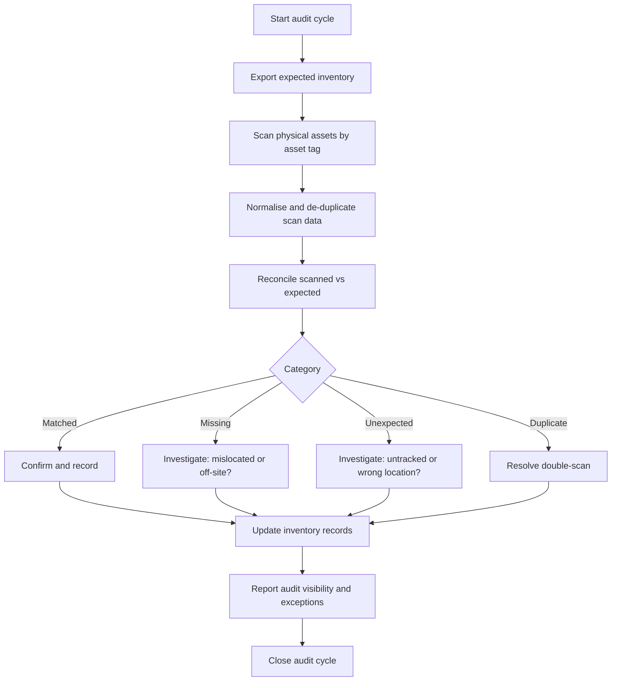

# Scan-Based Asset Audit — Process Map

A generic view of the standardised, scan-based stock audit workflow. It contains
no internal locations, systems or asset formats.

## Categories

| Category | Meaning | Typical follow-up |
|----------|---------|-------------------|
| Matched | Present and expected | Confirm and record |
| Missing | Expected but not scanned | Locate, or flag as off-site / in transit |
| Unexpected | Scanned but not expected | Add to records or correct location |
| Duplicate | Scanned more than once | Resolve double-scan, correct count |

## Notes

- Tags are normalised (trimmed and case-folded) before reconciliation.
- The demonstration tool implements exactly this reconciliation and category
  logic on synthetic data.
