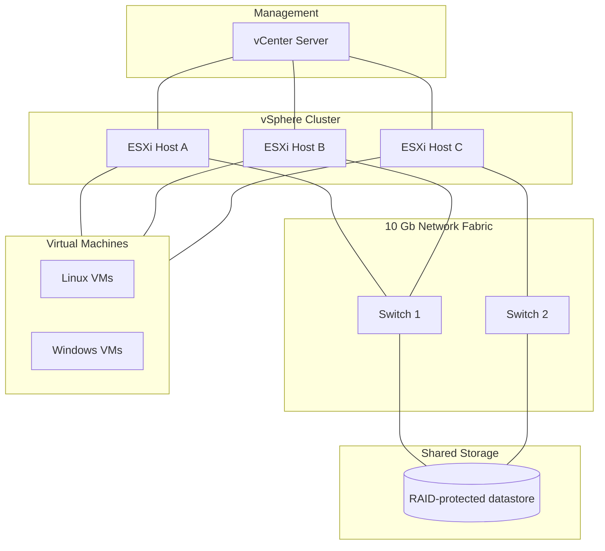

# Generic Virtualisation Architecture (Reference Pattern)

A high-level, **generic** reference pattern for a clustered VMware vSphere
environment. It intentionally does **not** represent the real internal topology,
host counts, addressing or naming — it exists only to illustrate the components
and relationships involved.

## Components

| Layer | Role |
|-------|------|
| Management | vCenter provides centralised management of the cluster. |
| Compute | Multiple ESXi hosts form a cluster for resilience and capacity. |
| Network | Redundant 10 Gb switching for host, storage and VM traffic. |
| Storage | Shared, RAID-protected datastore presented to all hosts. |
| Workloads | Linux and Windows virtual machines running operational services. |

## Design principles illustrated

- Redundancy at the host, network and storage layers.
- Shared storage to enable cluster features and VM mobility.
- Separation of management and workload responsibilities.
