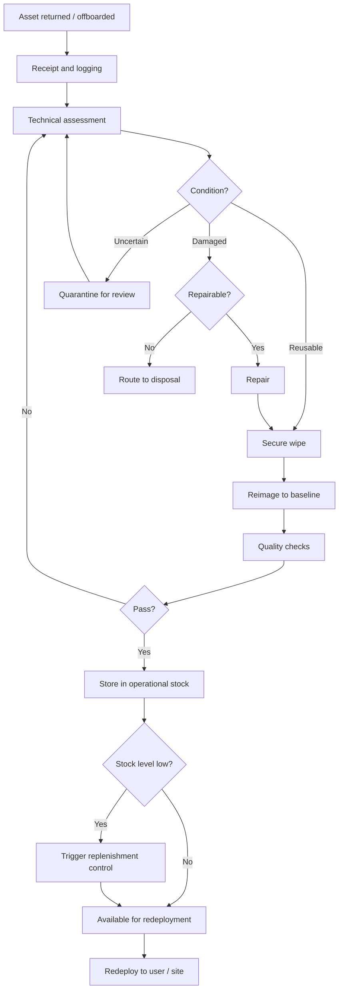

# Asset Return & Redeployment — Lifecycle Workflow

A generic end-to-end workflow for returned and offboarded IT assets, with
decision gates. It names no real product, location or routing.

## Decision gates

| Gate | Outcome |
|------|---------|
| Reusable | Proceed to secure wipe and reimage. |
| Damaged | Assess repairability; repair or route to disposal. |
| Quarantined | Hold for review, then re-assess. |
| Disposal-bound | Route to disposal following the agreed process. |

## Stages

1. Receipt and logging
2. Technical assessment
3. Secure wipe (generic)
4. Reimage to baseline
5. Quality checks
6. Storage in operational stock (with low-stock control)
7. Redeployment
