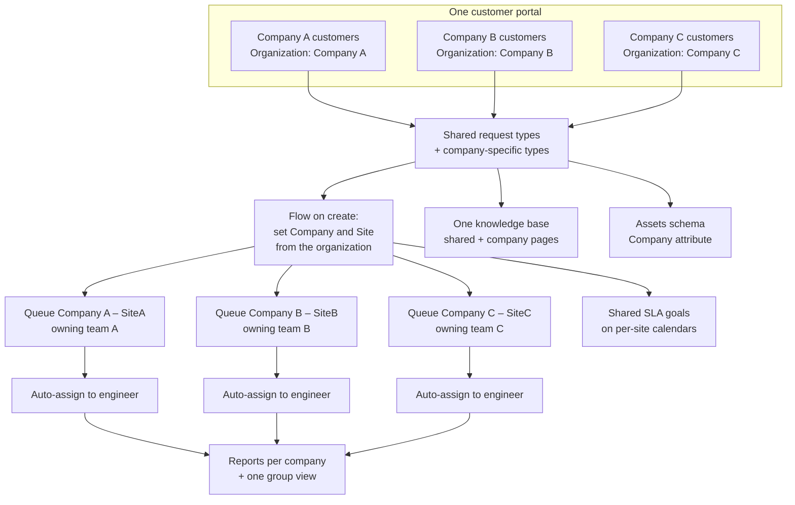

# Project 07 — Phase 5: administration and a Group service desk design

**Who this is for:** a Jira Service Management admin who has to run one IT
service desk for several companies in a group.
**What you can do after reading:** decide who can see and do what in a service
space, keep notifications useful, change a workflow without breaking the
desk, and plan a Group IT desk for three companies.

> Design document. Every company, site, person and work item here is
> synthetic. Each section says clearly what is **configured in the lab** and
> what is **design only**. The lab is a personal Jira Service Management Cloud
> site with **one account**, which is the site admin, the space admin and the
> only agent. The full lab settings are in
> [`configuration.md`](../configuration.md).

---

## Before you start

- Jira admin rights on the site, to edit permission, notification and
  workflow schemes.
- A sandbox, or a copy of the space, to test changes first. Atlassian
  Premium and Enterprise plans include sandboxes.
- A change ticket for every scheme change on a live desk. In this lab, changes
  go in the **IT Operations (ITSM)** space (see
  [build log, Step 12](../build-log.md#step-12--incident-problem-and-change-itsm)).

---

## 1. Permission scheme

### What it controls

A permission scheme decides what each person can do in a service space. In
Jira Service Management there are three kinds of people:

| Who | Licence | What they can do |
|---|---|---|
| **Agents** | Jira Service Management agent licence | Work the queues, reply to customers, add internal notes, change status, assign |
| **Customers** | No licence needed | Raise requests in the portal or by email, see and comment on their own requests (and on requests shared with them) |
| **Collaborators** | A licence for another Jira app, not an agent licence | View work items and add internal comments; they cannot reply to customers |

The main permissions:

| Permission | What it allows | Who should have it |
|---|---|---|
| Browse projects | See the space and its work items | Agents, collaborators, admins |
| Create work items | Raise work items inside Jira (customers raise them through the portal) | Agents, admins |
| Transition work items | Move work items through the workflow | Agents, admins |
| Assign / Assignable user | Assign work, and receive assigned work | Agents |
| Administer projects | Change request types, queues, SLAs, forms and space settings | Space admins only |

Customer access is set separately, in the space's customer permissions: who
can raise requests (only customers the team adds, or anyone) and whether
customers in the same **organization** can see each other's requests.

### Recommended setup for a Group IT desk (design)

Use **least privilege**: each person gets the smallest set of permissions they
need for their job, and nothing "just in case".

- Give permissions to **project roles** (Administrators, Service Desk Team,
  Service Desk Customers), not to named people. Add people to roles through
  groups from Entra ID, so access follows the identity lifecycle.
- **Agents:** Browse, Create, Transition, Assign, Assignable user. No
  Administer projects.
- **Space admins:** two named people, the service desk lead and one backup. Not
  every senior agent.
- **Site (Jira) admins:** a very small group, separate from daily agent work.
  Admin changes go through a change ticket.
- **Customers:** only customers added by the team or synced from the
  directory. Sharing inside the customer's own organization only.
- **Collaborators:** for teams that only need to read and add an internal note,
  for example the network team on a VPN incident.
- Review role membership every quarter, and remove leavers on the same day as
  the Leaver request.

### What is configured in the lab

| Item | Lab state |
|---|---|
| Permission scheme | The default scheme that Jira created with each space. **Not changed.** |
| Accounts | One account: site admin, space admin and agent |
| Customers | Test requests were raised through the portal by the same account |
| Roles, groups, collaborators | **Not configured.** The setup above is design only |

Because the lab has one user, it cannot prove least privilege. One control
did show up without any setup: on `IT-12` Jira listed the requester as an
*excluded approver*, so a person cannot approve their own request (see
[build log, Step 9](../build-log.md#step-9--testing-and-troubleshooting)).

---

## 2. Notification scheme

### Two kinds of notification

| Kind | Who receives it | Where it is set |
|---|---|---|
| **Customer notifications** | The requester, request participants, the organization | Space settings → Notifications → Customer notifications (one email template per event) |
| **Internal notifications** | Agents, assignees, watchers | The Jira notification scheme (events → recipients) |

### What to keep (design)

Customer side, keep:

- **Request created**: confirms the request arrived, with the reference.
- **Public comment added**: the customer sees every reply from the team.
- **Request resolved**: tells the customer the work is done.
- **Approval required**: for approvers on Access requests and changes.

Internal side, keep:

- **Work item assigned**: to the new assignee only.
- **Comment added**: to the assignee and watchers, not to the whole team.
- **Major incident**: to the incident manager and the on-call group, through
  one channel agreed in advance.

### Avoiding noise

- Do not send "work item updated" to the whole team. Agents learn to ignore
  email, and then they miss the one that matters.
- Use queues and the **SLA at risk – unassigned** queue for "what to work on
  next", not email.
- Automation that edits fields (for example setting Approvers) can fire extra
  notifications. Test a new flow and count the emails it sends.
- Internal notes never go to customers. Check this on every customer template
  change.

### What is configured in the lab

The default customer and internal notifications. **Not changed.** With one
account, every notification goes to the same person, so the lab cannot show
noise or routing. The list above is design only.

---

## 3. Workflow schemes

### How the mapping works

A **workflow scheme** maps each **work type** in a space to one **workflow**.
A request type uses the work type behind it, so it gets that workflow. To give
one request type its own workflow, give it its own work type and map that work
type to the new workflow.

### What is configured in the lab

| Space | Work type | Workflow |
|---|---|---|
| `IT` | Submit a request or incident | Default ESM workflow |
| `IT` | Questions, email requests | Simple ESM workflow |
| `IT` | **Access request** | **IT: Access request with approval** (own workflow, from the "Simple (with approval)" template) |
| `ITSM` | Change | Change workflow: Peer review → Planning → Awaiting CAB approval → Awaiting implementation → Implementing → Resolved |

Only the Access request work type uses **IT: Access request with approval**, so
New starter, Leaver and Laptop or device issue kept their workflow (see
[build log, Step 8](../build-log.md#step-8--workflow-and-approvals)). The
change path is the one change `ITSM-4` took, read from its history (see
[configuration, section 10](../configuration.md#10-change-workflow-and-cab-approval)).

### Change control for workflow edits (design)

A workflow edit can break automation. The lab shows this: the first access
request failed because the workflow had no To Do → In Review transition, and
the flow stopped (see
[build log, Step 9](../build-log.md#step-9--testing-and-troubleshooting)).

For every workflow edit on a live desk:

1. Raise a normal change in the `ITSM` space.
2. Copy the workflow before you edit it. The copy is the rollback.
3. List every automation flow, SLA condition and queue that uses a status in
   this workflow. SLAs often pause or stop on a status name.
4. Make the edit in the sandbox.
5. Raise one test request per affected request type in the sandbox.
6. Check the automation audit log and the SLA timers on each test request.
7. Publish the edit on the live site out of hours.
8. If you remove a status, map the open work items in that status to a new
   status when Jira asks.
9. Raise one test request on the live site and check it.
10. Record the result on the change ticket.

---

## 4. Design: one Group IT service desk for three companies

> **Design only.** Nothing in this section is configured in the lab. Company A,
> Company B and Company C, and sites SiteA, SiteB and SiteC, are synthetic.
> Each site is in a different country.

### The goal

One IT team supports three companies in one group. Each employee sees only
their own company's requests and articles. The IT team works one desk, with
clear ownership per company and per site, and the group sees one set of
reports, split by company.

### The design

| Part | Design |
|---|---|
| Service space | **One** service space for all three companies. One set of request types, SLAs and flows to maintain |
| Organizations | One per company: **Company A**, **Company B**, **Company C**. Customers are added to their company's organization. Sharing only inside the organization |
| Portal groups | The same groups for everyone: **Accounts & access**, **Hardware & devices**, **Software & SaaS**, **Workplace (meeting rooms, printers)** |
| Request types: shared | New starter, Leaver, Laptop or device issue, Access request, Meeting room problem. Same form and workflow for all companies |
| Request types: company-specific | Only when a company has its own system or process, for example a line-of-business app used by one company. Restrict who can raise it to that company's customers |
| Company field | Set from the reporter's organization by a flow when the request is created, so queues, SLAs and reports can filter on it |
| Queues | One queue per company and site, for example `Company A – SiteA`. Each queue has an **owning team**. JQL example: `Organizations = "Company A" AND Site = "SiteA" AND resolution = Unresolved` |
| Auto-assignment | A flow assigns each new request in a queue to an engineer in that queue's owning team (round robin or balanced workload). Work is never left unowned |
| Group queues | Keep **SLA at risk – unassigned** across all companies, so nothing breaches because it sat in the wrong queue |
| SLAs | **Shared** goals (same 1h/4h first response and 8h/24h resolution for everyone), each goal on the **calendar of the site**: SiteA, SiteB and SiteC working hours and public holidays |
| Knowledge base | **One** Confluence knowledge base. Shared articles for everyone (password reset, VPN, return your laptop). Company-specific pages labelled by company and restricted to that company where needed |
| Assets | One schema. A **Company** attribute on Employee, Laptop and Location. The Laptop field on the request form is scoped with AQL so each person picks from their company's laptops. Test the AQL in the Assets search first |
| Reporting | The same reports and dashboard for each company, filtered by organization: SLA met vs breached, created vs resolved, requests by request type. One group view on top |
| Approvals | Access requests go to the requester's manager. Changes go to one CAB for the group, with a member from each company |

### Onboarding a new company (Company D)

Run this as a normal change in the `ITSM` space.

1. Create the **Company D** organization.
2. Add Company D customers to the organization, or sync them from the
   directory.
3. Add the Company D site calendar, with its working hours and public
   holidays.
4. Add an SLA goal for Company D on that calendar, above the catch-all goal.
5. Add **Company D** as a value of the Company field and the Assets Company
   attribute.
6. Update the flow that sets Company and Site from the organization.
7. Create the queue `Company D – <site>` and name its owning team.
8. Add the owning team's engineers to the auto-assign flow.
9. Import Company D laptops into Assets with Company = Company D.
10. Add company-specific request types and knowledge base pages, only if
    Company D needs them.
11. Add Company D to the reports and dashboard filters.
12. Raise one test request as a Company D customer and check: queue, assignee,
    SLA calendar, laptop picker and portal visibility.
13. Confirm a Company A customer cannot see the Company D test request.

---

## 5. Risks and safe roll-out

### Risks

| Risk | What goes wrong | Control |
|---|---|---|
| Wrong sharing | A customer sees another company's requests | Share only inside the organization. Test with a customer from each company |
| Too many admins | Unreviewed changes break the desk | Two space admins, small site admin group, every change through a ticket |
| Workflow edit breaks a flow | Requests stop moving, approvals do not start | Map flows and SLAs to statuses before the edit; test in the sandbox (the lab hit this on `IT-11`) |
| SLA on the wrong calendar | Clocks run overnight or on a public holiday at one site | One calendar per site; check a test request from each site |
| Notification noise | Agents ignore email and miss the important one | Keep the short list in section 2; count emails during tests |
| Unowned work | A request lands in no queue | Catch-all queue and **SLA at risk – unassigned** across all companies |
| Assets field scope | A person picks another company's laptop | AQL scope by Company; test it in the Assets search first |

### How to roll out safely

1. **Change ticket.** Raise a normal change in `ITSM` with the plan, the test
   plan, the rollback plan and the communication. CAB approves it before work
   starts, as on `ITSM-4`.
2. **Sandbox.** Copy production to the sandbox and build the change there
   first.
3. **Test plan.** One test request per request type, per company. For each,
   check: the queue, the assignee, the SLA calendar and target, the
   notifications sent, the approval step and portal visibility. Check the
   automation audit log for every flow.
4. **Go live out of hours.** Turn on one company first. Add the others after
   a week without problems.
5. **Rollback.** Keep copies of the old workflows and schemes. To roll back,
   map the work types back to the old workflow scheme, switch the space back
   to the old permission and notification schemes, and turn off the new flows.
   Do not delete anything: the new items stay in place, unused, for review.
6. **Close the change.** Record the actual start and end, the test results and
   any issue on the change ticket.

---

## Related

- [Admin guide](../manuals/admin-guide.md): spaces, Assets, AQL, flows and the
  change workflow as built in the lab.
- [Scenario map](../scenario-map.md): common IT operations scenarios mapped to
  real work, this repository and the lab.
