# Project 07 — Build log: step by step

How I built the lab, in the order I built it. After completing Jira Service
Management training, I wanted to apply each topic on a real site rather than
only read about it, so every step below starts from a training topic, records
the decision I made and why, and ends with a check that it works.

Built on 11 November 2026 on a personal Jira Service Management Cloud site
(Free plan). Every work item in the screenshots is synthetic test data.

| Step | Training topic | What I built |
|---|---|---|
| 1 | Service spaces and the customer portal | IT service space and portal groups |
| 2 | Request types and request forms | Four request types with their own forms |
| 3 | SLAs and business calendars | Dublin office hours calendar |
| 4 | SLAs: goals and conditions | Time to first response and Time to resolution |
| 5 | Queues and JQL | SLA at risk – unassigned queue |
| 6 | Automation: triggers, conditions, actions | Onboarding (joiner) flow |
| 7 | Automation reuse | Offboarding (leaver) flow |
| 8 | Workflows and approvals | Access request approval workflow and flow |
| 9 | Testing and troubleshooting | End-to-end tests, audit log, fix |

---

## Step 1 — Service space and customer portal

**Training topic:** a service space holds the requests, queues and settings for
one service team; the customer portal is what employees see.

**What I did:** created an IT service space (key `IT`) from the IT service
management template, then organised the portal into portal groups by what the
employee needs: **Accounts & access** and **Hardware & devices**.

**Why:** employees should find the right form in one click, without knowing how
IT categorises work.

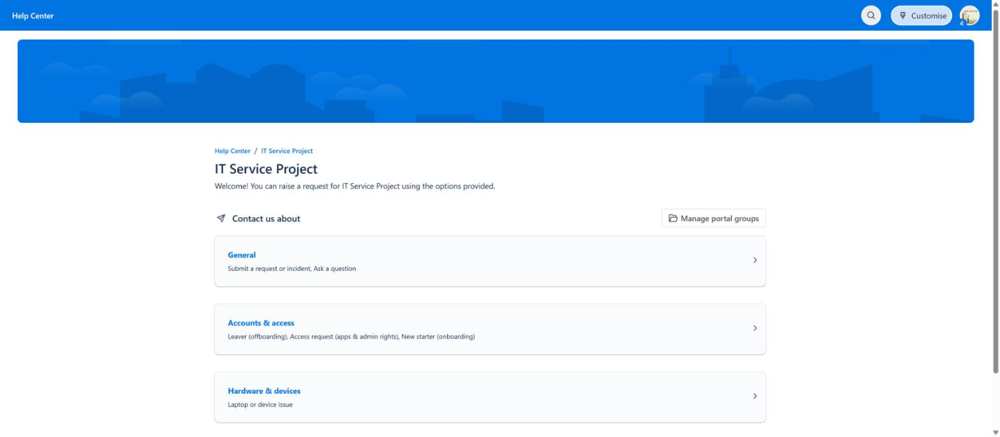

---

## Step 2 — Request types and request forms

**Training topic:** a request type is what the customer chooses in the portal;
behind it sit a work type, a workflow and a form.

**What I did:** created four request types from Atlassian templates and renamed
them in the employee's words:

- New starter (onboarding)
- Leaver (offboarding)
- Laptop or device issue
- Access request (apps & admin rights)

**Why:** templates give a sensible starting form; renaming and regrouping makes
the portal clear. The New starter form captures what the resolver needs up
front (name, employee ID, company email, role, team), so IT does not have to
chase details later.

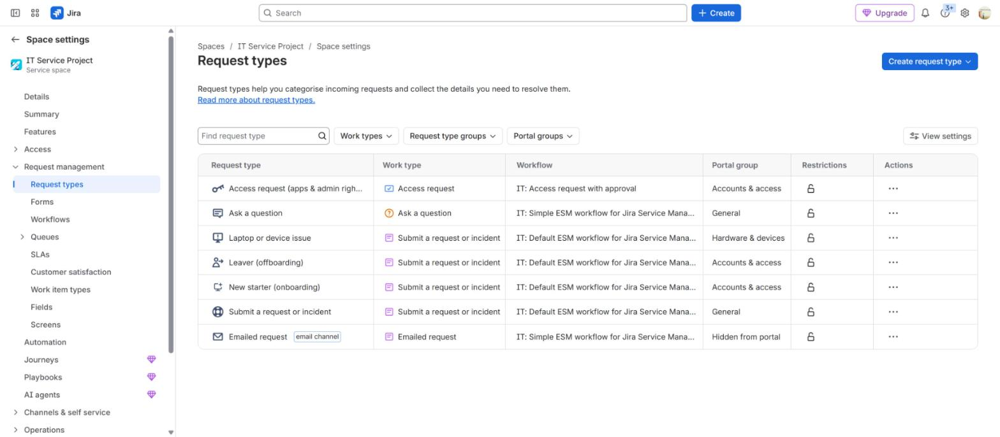


---

## Step 3 — Business-hours calendar

**Training topic:** SLAs should be measured against the hours the team actually
works, not 24/7.

**What I did:** created the **Dublin office hours** calendar: time zone
(GMT+00:00) Dublin, Monday–Friday 09:00–17:00, with Christmas Day and
St Patrick's Day as annual holidays.

**Why:** the site default time zone was not Dublin. Without an explicit
calendar, SLA clocks would run on the wrong hours and breach overnight.

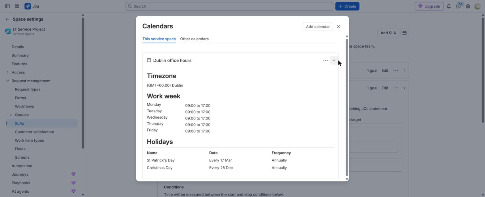

---

## Step 4 — SLAs: goals and conditions

**Training topic:** an SLA has goals (matched top to bottom with JQL, with a
catch-all last) and conditions (start, pause, stop).

**What I did:**

| SLA | High priority (`priority in (Highest, High)`) | Everything else |
|---|---|---|
| Time to first response | 1h | 4h |
| Time to resolution | 8h | 24h |

Both start when the work item is created and pause while the status is
**Pending** (waiting on the customer). First response stops on the first public
reply or on resolution; resolution stops when the resolution is set.

**Why:** the team should not be penalised for time the customer holds the
ticket, and high-priority work needs a tighter target.


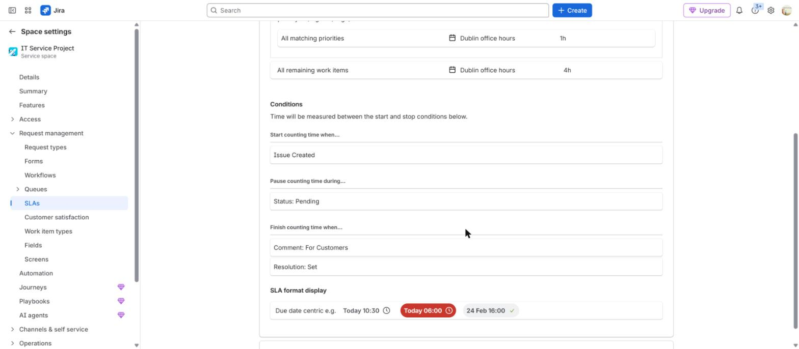

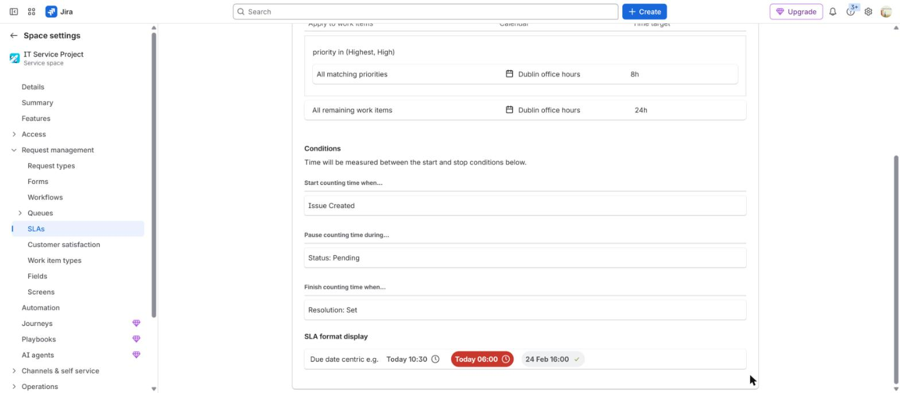

---

## Step 5 — Queue with JQL

**Training topic:** queues are saved JQL filters that tell agents what to work
on next.

**What I did:** created **SLA at risk – unassigned**:

```sql
resolution = Unresolved AND assignee IS EMPTY
AND "Time to first response" < remaining("2h")
ORDER BY "Time to first response" ASC
```

**Why:** the most useful queue is the one that shows problems before they
happen: tickets nobody owns that are about to breach, most urgent first.


---

## Step 6 — Onboarding automation (joiner)

**Training topic:** an automation flow is trigger → condition → action.

**What I did:** created **Onboarding - create sub-tasks for new starter**:

- Trigger: work item created
- Condition (JQL): `"Request Type" = "New starter (onboarding)"`
- Action: create four sub-tasks: Microsoft 365 account and licence; Entra ID
  security groups; laptop enrolment (Intune/Jamf) and record in Assets;
  application access and welcome email

**Why:** I used the request type as the condition, not keywords in the summary,
so the flow fires only for genuine onboarding requests. HR raises one request
and every team gets its task, with an audit trail.


---

## Step 7 — Offboarding automation (leaver)

**Training topic:** the same flow pattern can be reused for related processes.

**What I did:** created **Offboarding - create sub-tasks for leaver**, which
mirrors the onboarding flow with four leaver sub-tasks: block sign-in and
revoke sessions in Entra ID; convert the mailbox to shared and remove the
licence; collect, wipe and update the laptop record; remove application access
and group memberships.

**Why:** offboarding is a security control as much as an admin task. Blocking
sign-in and revoking sessions comes first.

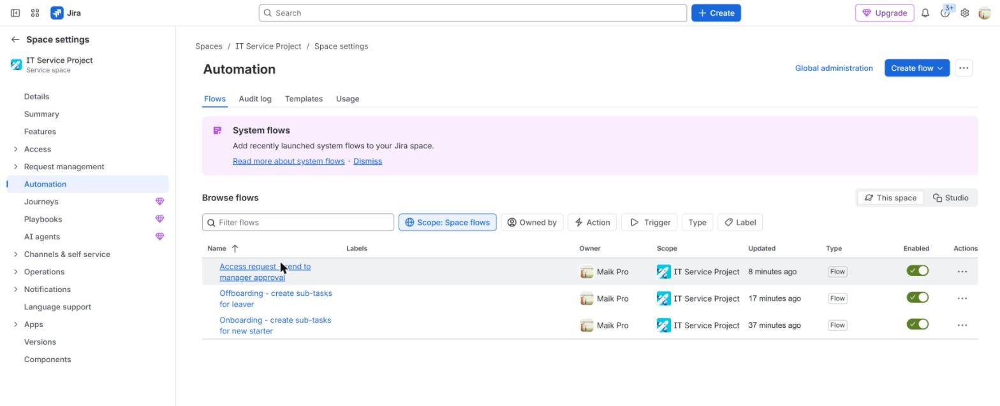

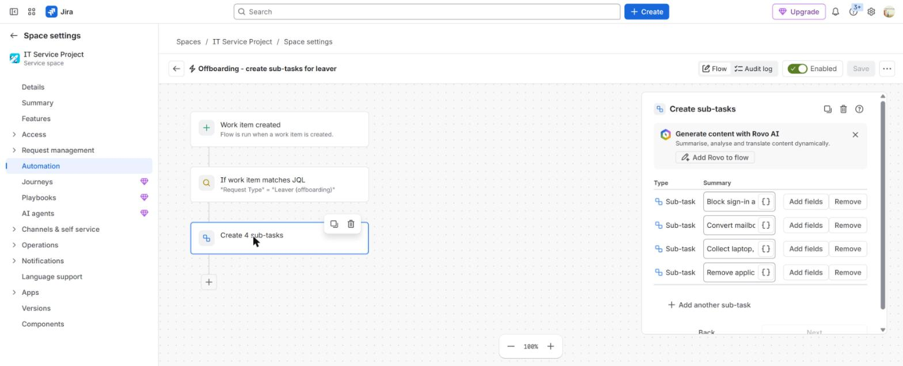

---

## Step 8 — Workflow and approvals

**Training topic:** approvals are configured on a workflow status; the
**Approvers** field decides who must approve.

**What I did:**

1. Replaced the Access request workflow with a new one, **IT: Access request
   with approval**, from the "Simple (with approval)" template. Only this
   request type uses it, so the other request types keep their workflow.
2. The **In Review** status requires one person in the Approvers field to
   approve.
3. Created **Access request - send to manager approval**: when an Access
   request is created, it sets the Approvers field and moves the work item into
   **In Review**.

**Why:** nobody should receive admin rights or system access without sign-off,
and the approval should start automatically rather than rely on an agent
remembering it.

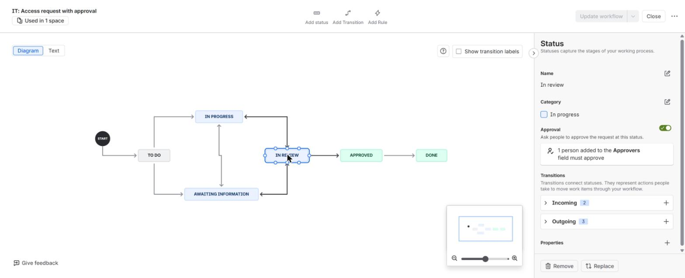

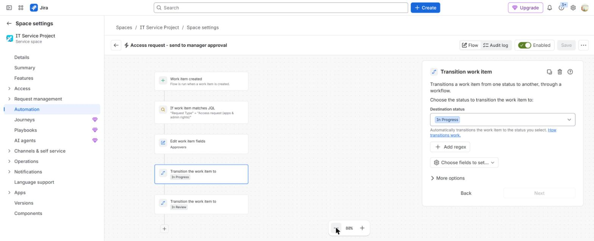

---

## Step 9 — Testing and troubleshooting

**Training topic:** test every change with a real request; use the automation
audit log when a flow does not behave.

**What I did:** raised synthetic requests through the portal for each process.

| Test | Result |
|---|---|
| New starter `IT-1` | Four sub-tasks created (`IT-2` to `IT-5`); both SLAs running |
| Leaver `IT-6` | Four sub-tasks created (`IT-7` to `IT-10`) |
| Access request `IT-11` | **Failed** — see below |
| Access request `IT-12` | In Review, waiting for 1 approval |


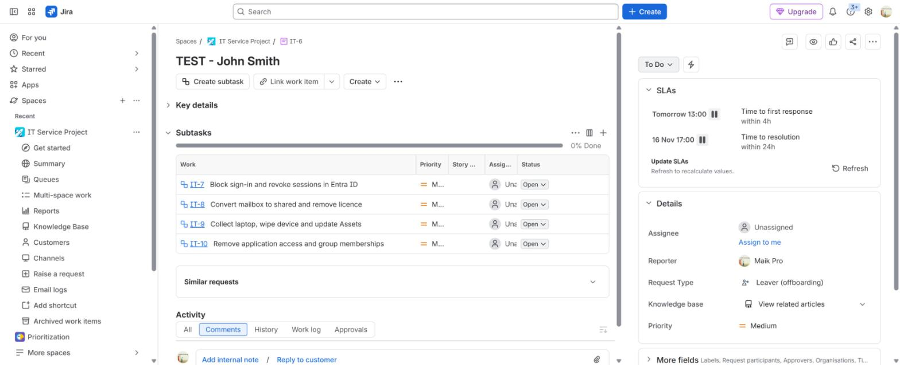

**The failure and the fix.** The first access request stayed in To Do. The
automation audit log showed the step that failed: *"Unable to transition your
issue to the selected status"*. The workflow had no direct transition from To Do
to In Review. I changed the flow to move the work item To Do → In Progress →
In Review, raised a second request, and it went straight into approval. The
audit log shows the failed run and the successful run after the fix.


**A control I did not have to build.** On `IT-12`, Jira listed the requester
under *excluded approvers*: a person cannot approve their own request. That is
segregation of duties enforced by the platform.

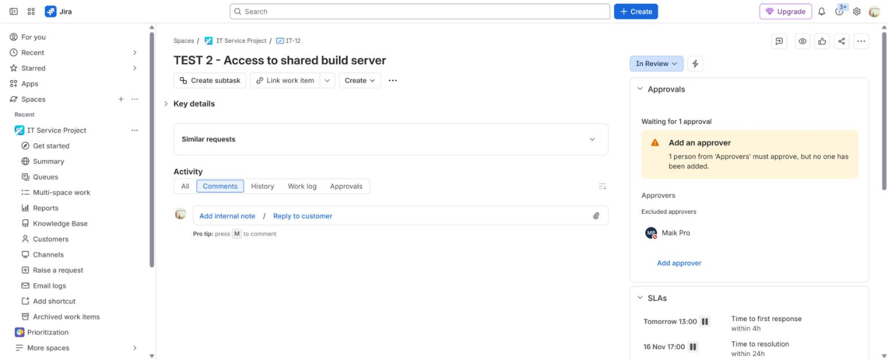

---

## What I would do next

- **Assets (CMDB):** a laptop object schema linked to the Laptop or device
  issue form (requires the Premium plan on this site).
- **Knowledge base:** Confluence articles linked to the portal for ticket
  deflection.
- **SSO and SCIM** from Entra ID so access to the service desk follows the
  identity lifecycle.
- **Approver from the manager field** instead of a fixed approver, once the
  site has more than one user.
