# Project 07 — Build log: step by step

How I built the lab, in the order I built it. After completing Jira Service
Management training, I wanted to apply each topic on a real site rather than
only read about it, so every step below starts from a training topic, records
the decision I made and why, and ends with a check that it works.

Started on 11 November 2026 on a personal Jira Service Management Cloud site
(Free plan, moved to a 30-day Premium trial at Step 11). Every work item,
person and asset in the screenshots is synthetic test data.

| Step | Training topic | What I built |
|---|---|---|
| 1 | Service spaces and the customer portal | IT service space and portal groups |
| 2 | Request types and request forms | Four request types with their own forms |
| 3 | SLAs and business calendars | Dublin office hours calendar |
| 4 | SLAs: goals and conditions | Time to first response and Time to resolution |
| 5 | Queues and JQL | SLA at risk – unassigned queue |
| 6 | Automation: triggers, conditions, actions | Onboarding (joiner) flow |
| 7 | Automation reuse | Offboarding (leaver) flow |
| 8 | Workflows and approvals | Access request approval workflow and flow |
| 9 | Testing and troubleshooting | End-to-end tests, audit log, fix |
| 10 | Knowledge base and self-service | Confluence knowledge base linked to the portal |
| 11 | Assets (CMDB) | Laptop schema, Assets field on the request form, automation, end-to-end test |
| 12 | Incident, problem and change management | IT Operations (ITSM) space: major incident, problem, normal change with CAB approval |
| 13 | IT asset management procedures | Scan-based laptop audit in Assets, laptop return on the Leaver request, two knowledge base articles |
| 14 | Reports and dashboards | SLA first response report and a service desk dashboard |

---

## Step 1 — Service space and customer portal

**Training topic:** a service space holds the requests, queues and settings for
one service team; the customer portal is what employees see.

**What I did:** created an IT service space (key `IT`) from the IT service
management template, then organised the portal into portal groups by what the
employee needs: **Accounts & access** and **Hardware & devices**.

**Why:** employees should find the right form in one click, without knowing how
IT categorises work.


---

## Step 2 — Request types and request forms

**Training topic:** a request type is what the customer chooses in the portal;
behind it sit a work type, a workflow and a form.

**What I did:** created four request types from Atlassian templates and renamed
them in the employee's words:

- New starter (onboarding)
- Leaver (offboarding)
- Laptop or device issue
- Access request (apps & admin rights)

**Why:** templates give a sensible starting form; renaming and regrouping makes
the portal clear. The New starter form captures what the resolver needs up
front (name, employee ID, company email, role, team), so IT does not have to
chase details later.


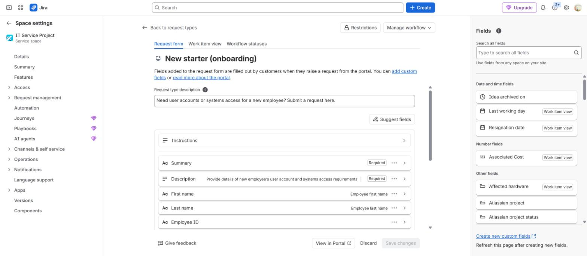

---

## Step 3 — Business-hours calendar

**Training topic:** SLAs should be measured against the hours the team actually
works, not 24/7.

**What I did:** created the **Dublin office hours** calendar: time zone
(GMT+00:00) Dublin, Monday–Friday 09:00–17:00, with Christmas Day and
St Patrick's Day as annual holidays.

**Why:** the site default time zone was not Dublin. Without an explicit
calendar, SLA clocks would run on the wrong hours and breach overnight.


---

## Step 4 — SLAs: goals and conditions

**Training topic:** an SLA has goals (matched top to bottom with JQL, with a
catch-all last) and conditions (start, pause, stop).

**What I did:**

| SLA | High priority (`priority in (Highest, High)`) | Everything else |
|---|---|---|
| Time to first response | 1h | 4h |
| Time to resolution | 8h | 24h |

Both start when the work item is created and pause while the status is
**Pending** (waiting on the customer). First response stops on the first public
reply or on resolution; resolution stops when the resolution is set.

**Why:** the team should not be penalised for time the customer holds the
ticket, and high-priority work needs a tighter target.

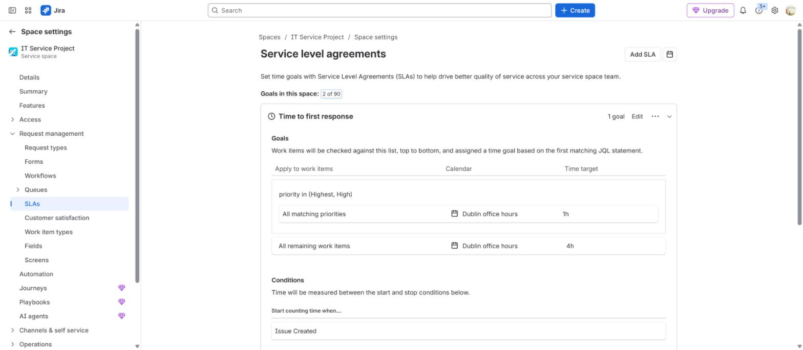


---

## Step 5 — Queue with JQL

**Training topic:** queues are saved JQL filters that tell agents what to work
on next.

**What I did:** created **SLA at risk – unassigned**:

```sql
resolution = Unresolved AND assignee IS EMPTY
AND "Time to first response" < remaining("2h")
ORDER BY "Time to first response" ASC
```

**Why:** the most useful queue is the one that shows problems before they
happen: tickets nobody owns that are about to breach, most urgent first.

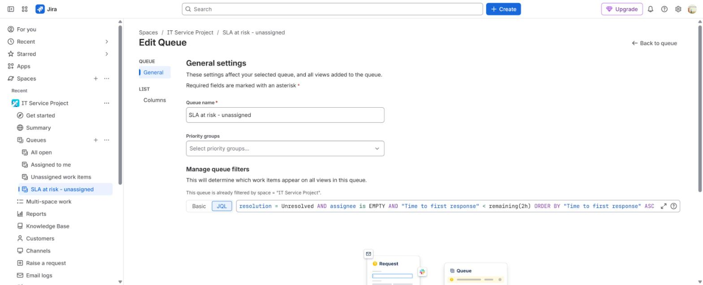

---

## Step 6 — Onboarding automation (joiner)

**Training topic:** an automation flow is trigger → condition → action.

**What I did:** created **Onboarding - create sub-tasks for new starter**:

- Trigger: work item created
- Condition (JQL): `"Request Type" = "New starter (onboarding)"`
- Action: create four sub-tasks: Microsoft 365 account and licence; Entra ID
  security groups; laptop enrolment (Intune/Jamf) and record in Assets;
  application access and welcome email

**Why:** I used the request type as the condition, not keywords in the summary,
so the flow fires only for genuine onboarding requests. HR raises one request
and every team gets its task, with an audit trail.

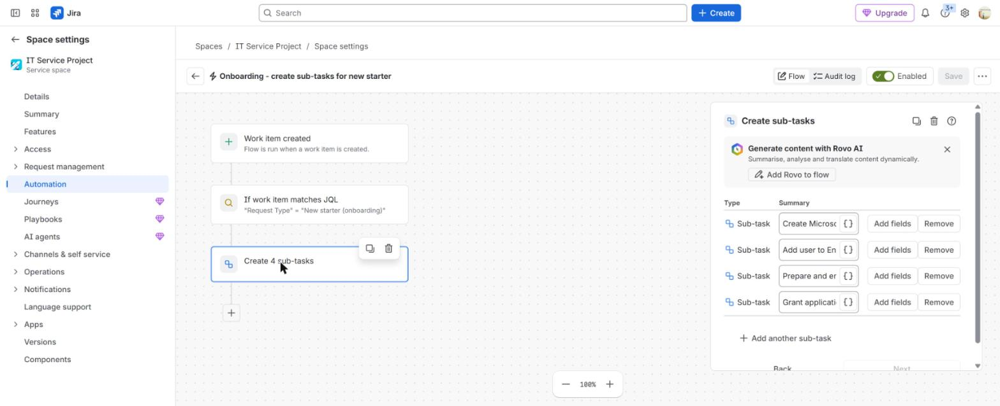

---

## Step 7 — Offboarding automation (leaver)

**Training topic:** the same flow pattern can be reused for related processes.

**What I did:** created **Offboarding - create sub-tasks for leaver**, which
mirrors the onboarding flow with four leaver sub-tasks: block sign-in and
revoke sessions in Entra ID; convert the mailbox to shared and remove the
licence; collect, wipe and update the laptop record; remove application access
and group memberships.

**Why:** offboarding is a security control as much as an admin task. Blocking
sign-in and revoking sessions comes first.


---

## Step 8 — Workflow and approvals

**Training topic:** approvals are configured on a workflow status; the
**Approvers** field decides who must approve.

**What I did:**

1. Replaced the Access request workflow with a new one, **IT: Access request
   with approval**, from the "Simple (with approval)" template. Only this
   request type uses it, so the other request types keep their workflow.
2. The **In Review** status requires one person in the Approvers field to
   approve.
3. Created **Access request - send to manager approval**: when an Access
   request is created, it sets the Approvers field and moves the work item into
   **In Review**.

**Why:** nobody should receive admin rights or system access without sign-off,
and the approval should start automatically rather than rely on an agent
remembering it.


---

## Step 9 — Testing and troubleshooting

**Training topic:** test every change with a real request; use the automation
audit log when a flow does not behave.

**What I did:** raised synthetic requests through the portal for each process.

| Test | Result |
|---|---|
| New starter `IT-1` | Four sub-tasks created (`IT-2` to `IT-5`); both SLAs running |
| Leaver `IT-6` | Four sub-tasks created (`IT-7` to `IT-10`) |
| Access request `IT-11` | **Failed** — see below |
| Access request `IT-12` | In Review, waiting for 1 approval |

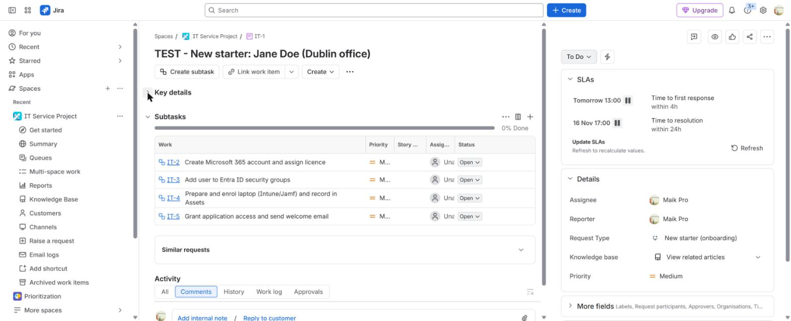


**The failure and the fix.** The first access request stayed in To Do. The
automation audit log showed the step that failed: *"Unable to transition your
issue to the selected status"*. The workflow had no direct transition from To Do
to In Review. I changed the flow to move the work item To Do → In Progress →
In Review, raised a second request, and it went straight into approval. The
audit log shows the failed run and the successful run after the fix.

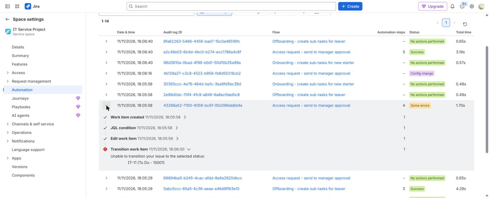

**A control I did not have to build.** On `IT-12`, Jira listed the requester
under *excluded approvers*: a person cannot approve their own request. That is
segregation of duties enforced by the platform.


---

## Step 10 — Knowledge base and self-service

**Training topic:** a knowledge base linked to the portal lets employees solve
common problems themselves before raising a ticket (ticket deflection).

**What I did:**

1. Moved Confluence on the site to the **Free** plan and gave my account access.
2. Created a Confluence space, **IT Help Centre**, with the knowledge base
   purpose.
3. Linked it to the service space as an **external** knowledge base, so
   employees can see it in the portal.
4. Wrote three articles for the most common first-line requests: *How to reset
   your password*, *How to connect to the VPN when working remotely* and
   *My laptop is slow - first steps*. Each ends by telling the employee which
   request type to raise if the steps do not work.

**Why:** password resets, VPN problems and slow laptops are repeat tickets.
Good self-help articles reduce volume and leave agents for real problems.

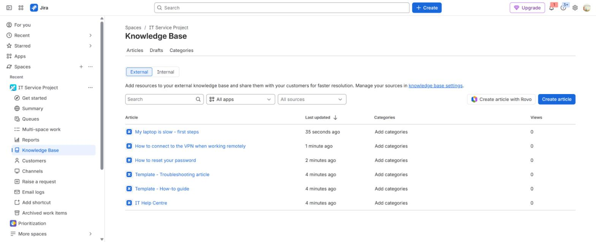

**Test:** in the customer portal, a search for *password* returned the article
under **Self-help resources**, with its content preview, before any request was
raised.

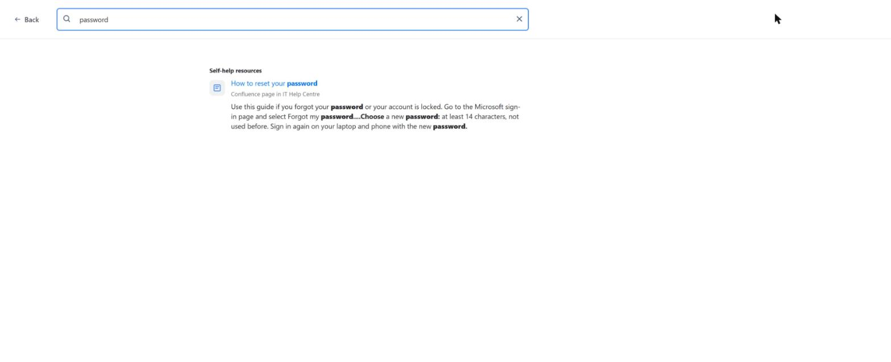

---

## Step 11 — Assets: laptops linked to requests

**Training topic:** Assets is the configuration management database (CMDB) in
Jira Service Management. Object schemas hold object types (for example laptops
and people), each with attributes; an Assets custom field lets a request point
at a real object.

**What I did:**

1. Started a 30-day Premium trial on the site, which includes Assets, and gave
   my account the **Assets App admin** role in Atlassian Administration (Assets
   is now a separate platform app, so the role must be granted there).
2. Created an object schema, **IT Assets** (key `ITA`), with four object types:
   **Location**, **Employee**, **Model** and **Laptop**.
3. Gave **Laptop** the attributes an IT team needs: serial number (unique),
   model, assigned to, location, status (In use, In stock, In repair, Retired),
   encryption (FileVault or BitLocker), managed by, purchase date and warranty
   end. Model, Assigned to and Location are references to the other object
   types, so the schema shows who has which laptop and where it is.
4. Loaded synthetic data: 3 locations, 4 models, 5 employees and 8 laptops
   (in use, in stock, in repair and retired).

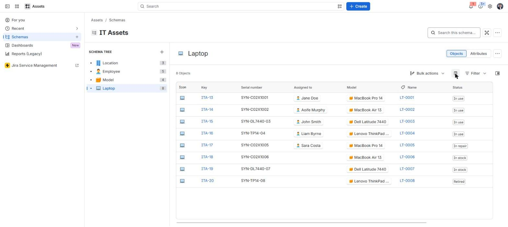

5. Created an **Assets objects** custom field, **Laptop**, scoped with AQL to
   `objectType = "Laptop" AND Status != "Retired"`, searchable by name and
   serial number, and showing serial number, model, assigned to and status on
   the work item.

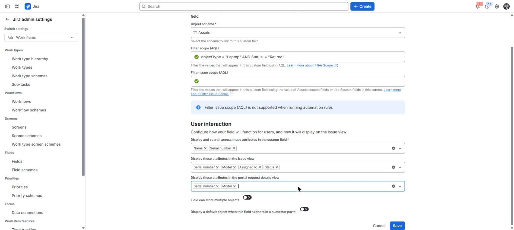

6. Added the field to the **Laptop or device issue** request form as a required
   question, *Which laptop?*, with help text, and removed the old free-text
   hardware field.

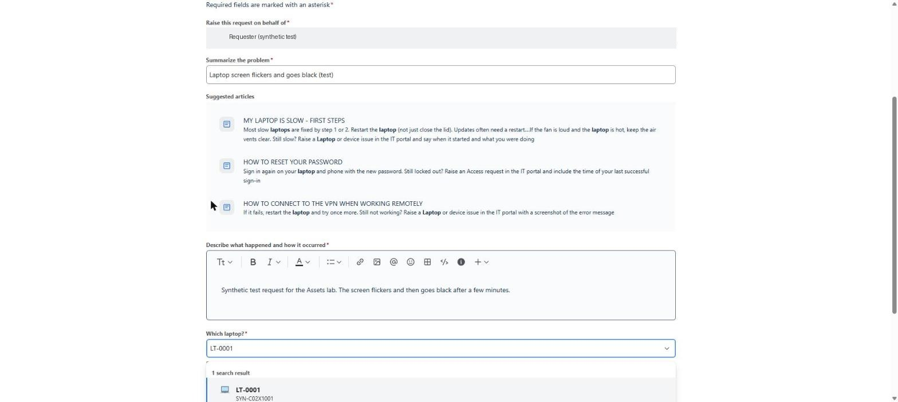

7. Built a flow, **Laptop issue - set asset status to In repair**: when a
   Laptop or device issue is created with a laptop selected, an AQL branch finds
   that laptop and an **Edit object** action sets its status to *In repair*.

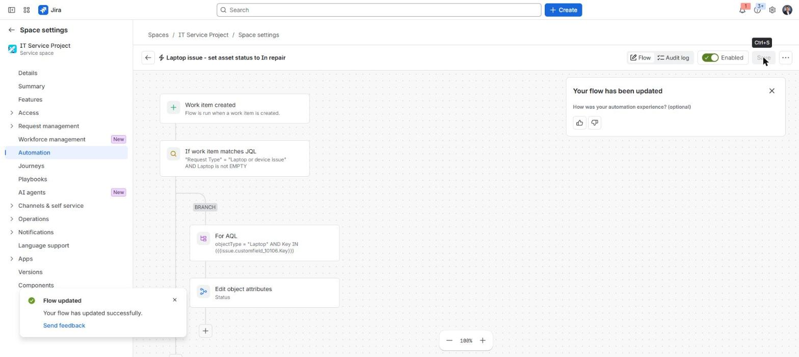

**Why:** a free-text "affected hardware" box gives agents nothing to work with.
Linking the request to the real asset shows the serial number, model and owner
straight away, and keeps the inventory status correct without manual updates.

**Test:** raised `IT-13` in the portal for `LT-0001` (status *In use*). The work
item shows the laptop with its serial number, model and owner, and the flow
changed the laptop's status to **In repair**.

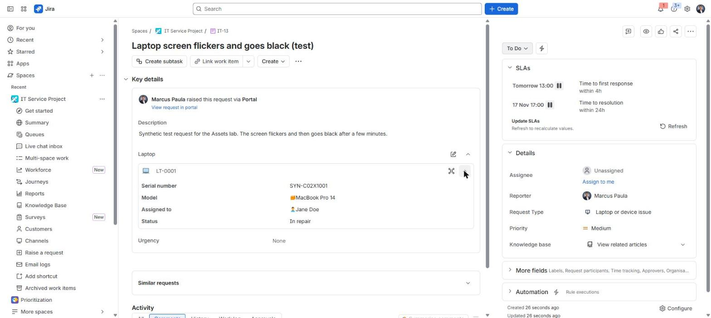

---

## Step 12 — Incident, problem and change (ITSM)

**Training topic:** incident management restores service fast; problem
management finds the root cause behind repeat incidents; change management
controls risk before a change is made.

**What I did:**

1. Created a second service space, **IT Operations (ITSM)** (key `ITSM`), for
   incidents, problems and changes, with two components: **Office Network** and
   **VPN Server**.
2. Raised three synthetic incidents about the same outage:
   - `ITSM-1` *Office internet dropped for 10 minutes (test)*
   - `ITSM-3` *Cannot sign in to Microsoft 365 from the office (test)*
   - `ITSM-2` *Office has no internet and users cannot connect to the VPN
     (test)*
3. Treated `ITSM-2` as the major incident: priority **Highest**, impact
   **Extensive / Widespread**, **Major incident** flag on. Its SLAs were time to
   first response within 2h and time to resolution within 4h.
4. Recorded the timeline in comments:

   | Time | Entry | Visibility |
   |---|---|---|
   | 09:00 | Incident starts | — |
   | 09:20 | ISP line down at the router; ISP ticket raised with evidence (WAN down, no sync); Group IT informed | Internal note |
   | 09:50 | ISP fixed a fault on their side; WAN up, VPN up, test sign-in to Microsoft 365 OK | Internal note |
   | 09:50 | "Service restored at 09:50. ISP fault on their side. Root cause follow-up in problem ITSM-5." | Public reply |

5. Completed all three incidents.

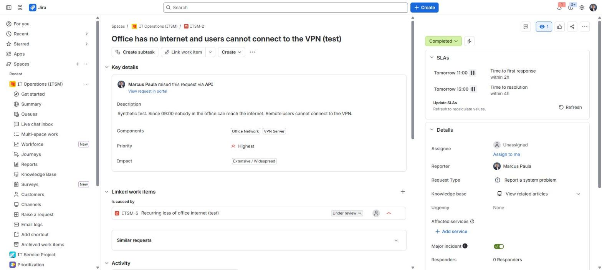

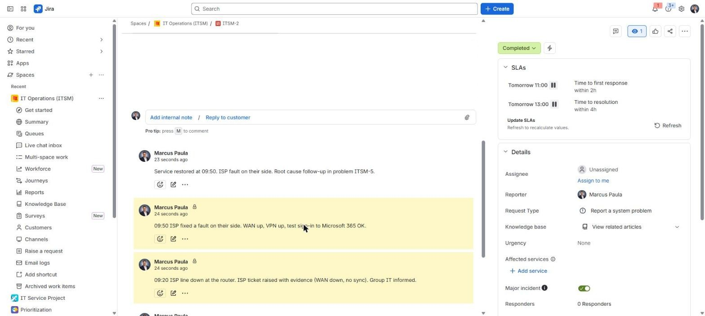

6. Raised problem `ITSM-5` *Recurring loss of office internet (test)*,
   priority **High**, status **Under review**:
   - **Root cause:** the ISP line had a recurring fault, and the office has
     only one internet line. Every fault stops internet, VPN and Microsoft 365
     sign-in in the office.
   - **Workaround:** mobile hotspot for urgent work; cloud apps still work from
     outside the office.
   - **Links:** causes `ITSM-1`, `ITSM-2` and `ITSM-3`; relates to `ITSM-4`.

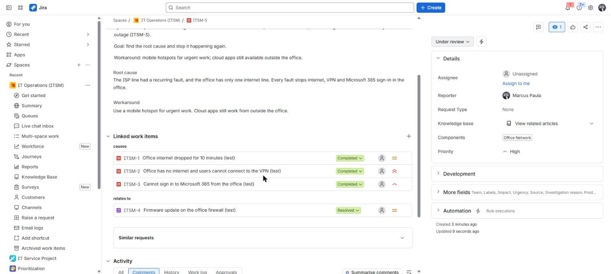

7. Raised change `ITSM-4` *Firmware update on the office firewall (test)* with
   the request type **Upgrade or change a managed system**: change type
   **Normal**, risk **Medium**, reason **Upgrade**.
   - **Plan:** back up the configuration, update out of hours (Saturday
     08:00–09:00), then test internet, VPN and Wi-Fi.
   - **Rollback:** restore the previous firmware and the saved configuration.
   - **Communication:** notify staff two days before and when complete.
   - **Dates recorded on the change:** planned start 21 Nov 2026 08:00, actual
     start 08:05, actual end 08:40.
8. Moved the change through the workflow: peer review → **Planning** →
   **Awaiting CAB approval** → **Awaiting implementation** → **Implementing** →
   **Resolved**.

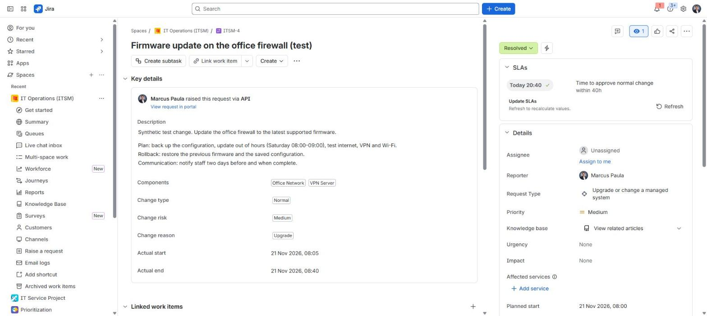

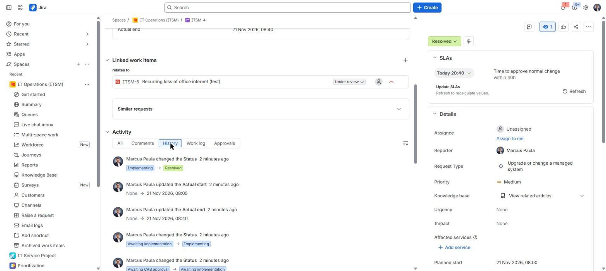

**Why:** in IT operations one outage often arrives as several tickets from
different people. Marking one as the major incident keeps the communication in
one place. Linking the incidents to a problem stops the team from closing the
same fault again and again. The firewall change shows that a change has a plan,
a rollback and a communication step before anyone touches the device.

**Test:** `ITSM-2` showed both SLAs (2h first response, 4h resolution) and
the full timeline; all three incidents were completed. `ITSM-5` shows the three
incidents as linked work items. The `ITSM-4` history shows every workflow
status in order, and the SLA **Time to approve normal change** (40h) was met.

---

## Step 13 — Asset audit and laptop return

**Training topic:** Assets keeps the inventory true only if the team checks it
against the real world and updates it at every lifecycle event.

**What I did:**

1. Added three attributes to the **Laptop** object type: **Last audit date**,
   **Audit result** (Found / Found - wrong location / Missing) and
   **Condition**.
2. Recorded a synthetic scan-based audit of the 8 laptops on 12 Nov 2026:

   | Result | Laptops | Action |
   |---|---|---|
   | Found | 5 | Includes `LT-0008` (Retired), seen in the IT Storage Room |
   | Found - wrong location | 2 | `LT-0001`: register corrected to IT Storage Room. `LT-0006`: laptop moved back to storage |
   | Missing | 1 | `LT-0007`: follow-up ticket `IT-14` raised |

   `LT-0008` has the status **Retired**.

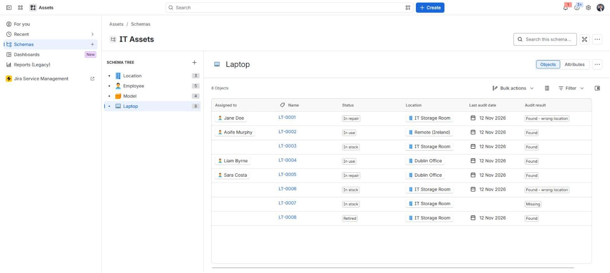

3. Processed a laptop return on the Leaver request `IT-6`. When sub-task `IT-9`
   (*Collect laptop, wipe device and update Assets*) was done, `LT-0003` changed
   as follows:

   | Attribute | Before | After |
   |---|---|---|
   | Assigned to | John Smith | None |
   | Status | In use | In stock |
   | Location | Dublin Office | IT Storage Room |
   | Condition | (new attribute) | Good |
   | Audit result | (new attribute) | Found |

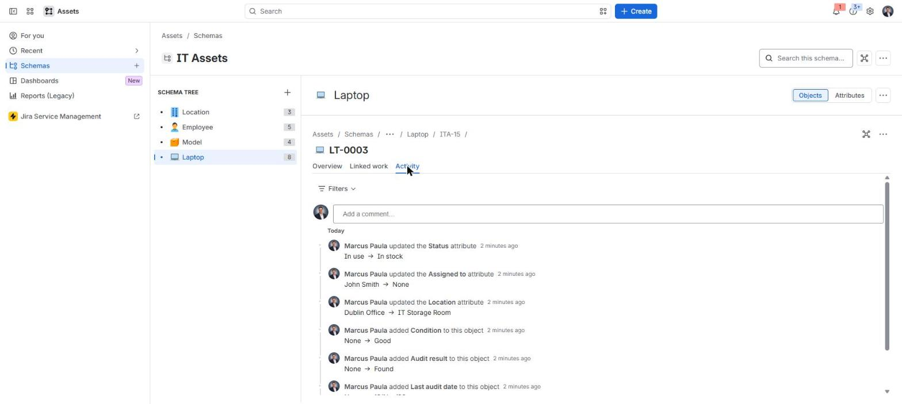

4. Wrote two articles in the **IT Help Centre**: *How to find your laptop asset
   tag and report a problem* and *How to return your laptop when you leave*.

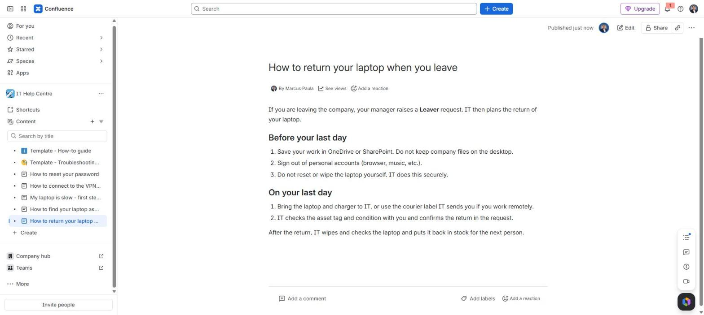

**Why:** an inventory nobody audits drifts away from reality. Two kinds of
"wrong location" need different fixes: sometimes the register is wrong,
sometimes the laptop is. A returned laptop that stays assigned to a leaver is
invisible stock, so the return must update owner, status, location and
condition in one step.

**Test:** the Assets history for `LT-0003` shows each attribute change. The
audit view shows the Audit result for all laptops, and `IT-14` exists for the
missing laptop.

A small Python tool, [`tools/asset-audit-reconcile/`](tools/asset-audit-reconcile/),
compares a scan CSV against an Assets export and sorts each laptop into Found,
Found - wrong location, Missing or Unexpected. The full procedure is in
[`procedures/scan-based-asset-audit.md`](procedures/scan-based-asset-audit.md).

---

## Step 14 — Reports and dashboard

**Training topic:** reports show whether the service desk meets its targets;
dashboards put the key numbers on one page.

**What I did:**

1. Created a custom report, **SLA: first response met vs breached**, with two
   series: **Met** and **Breached**.
2. Created a dashboard, **IT service desk overview (lab)**, with a created vs
   resolved chart and a pie chart of work items by work type.

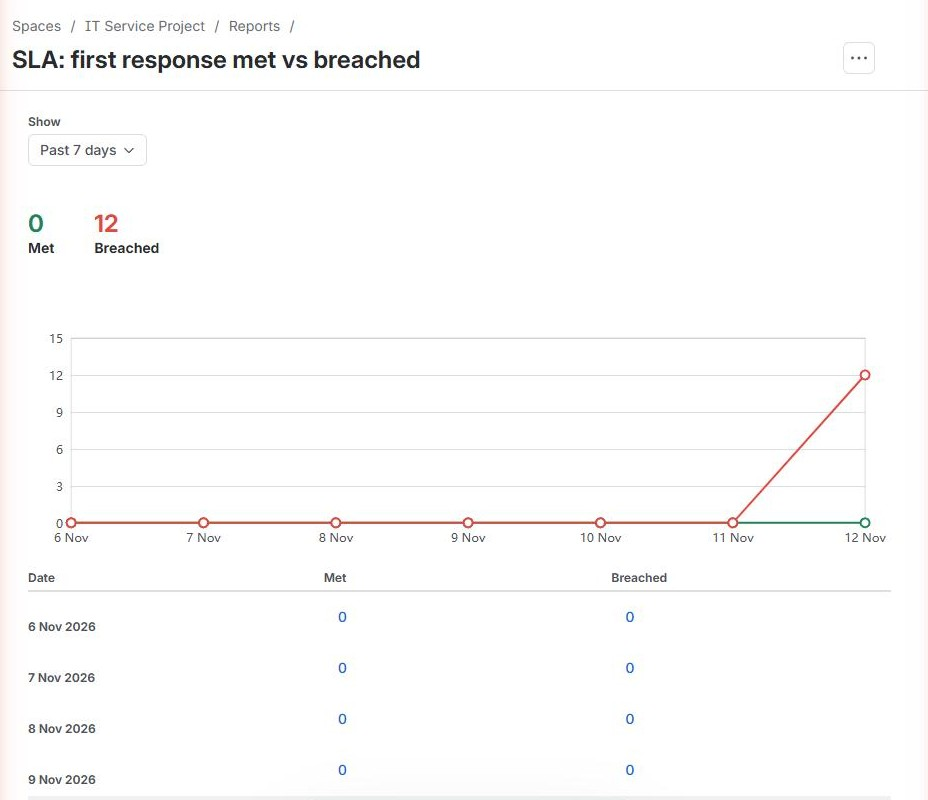

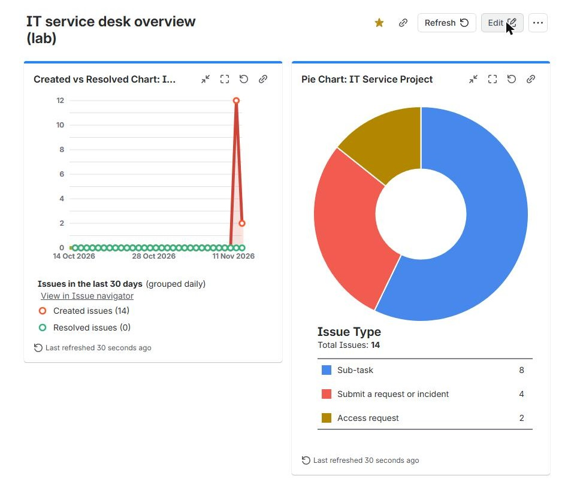

**Why:** an SLA is only useful if someone looks at the result. Met vs breached
shows the trend; created vs resolved shows whether the backlog grows.

**Result:** the report showed 0 Met and 12 Breached for first response. That is
correct for the lab: the test requests were raised to test forms and flows, and
nobody sent a first public reply within the target. In a real desk this is the
signal to look at the *SLA at risk – unassigned* queue and at staffing. The
dashboard showed 14 work items created and 0 resolved in the last 30 days, split
into 8 sub-tasks, 4 requests and incidents and 2 access requests. Requests by
request type is not a statistic in the pie chart gadget, so the chart uses work
type; a by-request-type view is available in the built-in service space reports.

---

## What I would do next

- **Assets:** a flow that sets the laptop back to *In use* when the request is
  resolved.
- **Knowledge base:** more articles, with categories, and reporting on which
  searches end without an article.
- **SSO and SCIM** from Entra ID so access to the service desk follows the
  identity lifecycle.
- **Approver from the manager field** instead of a fixed approver, once the
  site has more than one user.
