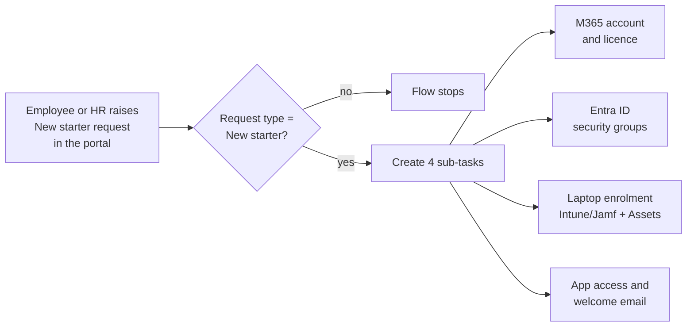
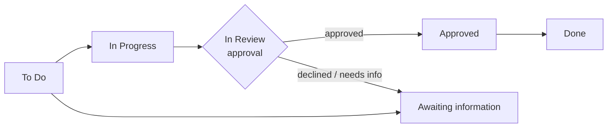

# Project 07 — Configuration

Configuration of the personal Jira Service Management Cloud lab, as built in
November 2026. Atlassian now calls projects **spaces**, automation rules
**flows** and issues **work items**; this document uses the current terms.

## 1. Service space

| Setting | Value |
|---|---|
| Space type | Jira Service Management — IT service space |
| Space key | `IT` |
| Workflows in use | Default ESM workflow (requests and incidents), Simple ESM workflow (questions, email) |

## 2. Request types and portal groups

| Request type | Created from template | Work type | Portal group |
|---|---|---|---|
| New starter (onboarding) | Set up new user accounts and systems access | Submit a request or incident | Accounts & access |
| Leaver (offboarding) | Offboard an employee | Submit a request or incident | Accounts & access |
| Access request (apps & admin rights) | Request admin access | Access request (own approval workflow) | Accounts & access |
| Laptop or device issue | Report broken hardware | Submit a request or incident | Hardware & devices |

Request form fields (New starter): summary, account and access requirements,
employee first name, last name, employee ID, company email address, role and
team.

Design note: request types are named in the employee's words ("Laptop or device
issue") and grouped by what the employee needs, so the portal stays short and
the right form is chosen first time.

## 3. SLA calendar

| Setting | Value |
|---|---|
| Name | Dublin office hours |
| Time zone | (GMT+00:00) Dublin |
| Working week | Monday–Friday, 09:00–17:00 |
| Holidays | Christmas Day (25 Dec, annual), St Patrick's Day (17 Mar, annual) |

The site default time zone differed from Dublin, so the calendar sets the time
zone explicitly; otherwise SLA clocks would run on the wrong working hours.

## 4. SLA — Time to first response

Goals are evaluated top to bottom; the first matching JQL wins.

| Applies to (JQL) | Calendar | Target |
|---|---|---|
| `priority in (Highest, High)` | Dublin office hours | 1h |
| All remaining work items | Dublin office hours | 4h |

| Condition | Value |
|---|---|
| Start counting | Work item created |
| Pause counting | Status: Pending (waiting on the customer) |
| Stop counting | Comment: for customers, or Resolution: set |

## 4b. SLA — Time to resolution

| Applies to (JQL) | Calendar | Target |
|---|---|---|
| `priority in (Highest, High)` | Dublin office hours | 8h |
| All remaining work items | Dublin office hours | 24h |

| Condition | Value |
|---|---|
| Start counting | Work item created |
| Pause counting | Status: Pending |
| Stop counting | Resolution: set |

## 5. Queue — SLA at risk – unassigned

```sql
resolution = Unresolved
AND assignee IS EMPTY
AND "Time to first response" < remaining("2h")
ORDER BY "Time to first response" ASC
```

Columns: work type, key, summary, reporter, assignee, status, created and
Time to first response. The queue shows only work nobody owns yet that is
within two working hours of breaching, most urgent first.

## 6. Automation flow — onboarding sub-tasks

| Step | Configuration |
|---|---|
| Name | Onboarding - create sub-tasks for new starter |
| Trigger | Work item created |
| Condition | JQL: `"Request Type" = "New starter (onboarding)"` |
| Action | Create sub-tasks (4) |

Sub-tasks created:

1. Create Microsoft 365 account and assign licence
2. Add user to Entra ID security groups
3. Prepare and enrol laptop (Intune/Jamf) and record in Assets
4. Grant application access and send welcome email



## 6b. Automation flow — offboarding sub-tasks

| Step | Configuration |
|---|---|
| Name | Offboarding - create sub-tasks for leaver |
| Trigger | Work item created |
| Condition | JQL: `"Request Type" = "Leaver (offboarding)"` |
| Action | Create sub-tasks (4) |

Sub-tasks created:

1. Block sign-in and revoke sessions in Entra ID
2. Convert mailbox to shared and remove licence
3. Collect laptop, wipe device and update Assets
4. Remove application access and group memberships

## 6c. Access request approval

The Access request type uses its own workflow, **IT: Access request with
approval**, created from the "Simple (with approval)" template so the other
request types keep their workflow unchanged.



| Item | Configuration |
|---|---|
| Approval status | In Review — 1 person from the **Approvers** field must approve |
| Flow name | Access request - send to manager approval |
| Trigger | Work item created |
| Condition | JQL: `"Request Type" = "Access request (apps & admin rights)"` |
| Actions | Edit work item: set Approvers → Transition to In Progress → Transition to In Review |

The workflow has no direct To Do → In Review transition, so the flow moves the
work item through In Progress first. The first test run failed on exactly this
point; the automation audit log showed the failed transition and the flow was
corrected (see the evidence file).

## 6d. Knowledge base

| Setting | Value |
|---|---|
| Confluence plan | Free |
| Space | IT Help Centre (knowledge base purpose) |
| Link type | External knowledge base (visible to customers in the portal) |
| Articles | How to reset your password · How to connect to the VPN when working remotely · My laptop is slow - first steps |

## 7. Next steps (not yet configured)

- Assets schema for laptops, imported from the device-management tool, linked
  to the Laptop or device issue form.
- Offboarding flow mirroring the onboarding flow.

## 8. Assets (CMDB)

Schema **IT Assets** (key `ITA`). All objects are synthetic.

| Object type | Attributes | Objects |
|---|---|---|
| Location | Name, City | 3 |
| Employee | Name, Email, Department, Location (reference) | 5 |
| Model | Name, Manufacturer, Operating system (macOS / Windows) | 4 |
| Laptop | Name (asset tag), Serial number (unique), Model (reference), Assigned to (reference), Location (reference), Status (In use / In stock / In repair / Retired), Encryption (FileVault / BitLocker), Managed by, Purchase date, Warranty end | 8 |

### Assets field

| Setting | Value |
|---|---|
| Field | Laptop (`customfield_10106`), Assets objects |
| Schema | IT Assets |
| Filter scope (AQL) | `objectType = "Laptop" AND Status != "Retired"` |
| Search by | Name, Serial number |
| Shown on work item | Serial number, Model, Assigned to, Status |
| Shown in portal | Serial number, Model |
| Request form | Laptop or device issue: required, shown as *Which laptop?* |

### Flow — Laptop issue: set asset status to In repair

| Step | Configuration |
|---|---|
| Trigger | Work item created |
| Condition | JQL: `"Request Type" = "Laptop or device issue" AND Laptop is not EMPTY` |
| Branch | AQL on IT Assets: `objectType = "Laptop" AND Key IN ({{issue.customfield_10106.Key}})` |
| Action | Edit object: Status = In repair |
