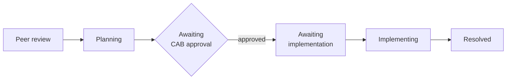

# Project 07 — Admin guide

**Who this is for:** the Jira Service Management admin who maintains this lab.
**What you can do after reading:** find each part of the configuration, change
it safely, write AQL for the laptop schema and run the audit reconcile tool.

> Lab guide. The site is a personal Jira Service Management Cloud site on a
> 30-day Premium trial. All objects and work items are synthetic. The full
> settings are in [`configuration.md`](../configuration.md); this guide explains
> how the parts fit together.

---

## Before you start

- Jira admin rights on the site.
- The **Assets App admin** role, granted in Atlassian Administration. Assets is
  a separate platform app; Jira admin rights alone do not open it.
- An active Premium plan or trial. In this lab, Assets came with the Premium
  trial.

---

## 1. Spaces

| Space | Key | Holds |
|---|---|---|
| IT service space | `IT` | Employee requests: New starter, Leaver, Laptop or device issue, Access request |
| IT Operations (ITSM) | `ITSM` | Incidents, problems and changes. Components: Office Network, VPN Server |

---

## 2. Assets schema

Schema **IT Assets**, key `ITA`.

| Object type | Attributes |
|---|---|
| Location | Name, City |
| Employee | Name, Email, Department, Location (reference) |
| Model | Name, Manufacturer, Operating system (macOS / Windows) |
| Laptop | Name (asset tag), Serial number (unique), Model (reference), Assigned to (reference), Location (reference), Status, Encryption (FileVault / BitLocker), Managed by, Purchase date, Warranty end, Last audit date, Audit result, Condition |

Laptop values:

| Attribute | Values |
|---|---|
| Status | In use / In stock / In repair / Retired |
| Audit result | Found / Found - wrong location / Missing |
| Condition | For example Good |

Rules:

- **Serial number** is unique. Assets rejects a second laptop with the same
  serial.
- **Model**, **Assigned to** and **Location** are references. Change the
  referenced object, not free text.
- Never delete a retired laptop. Set Status to **Retired**. The history stays
  and the request form hides it.

---

## 3. AQL

### Used in the lab

Assets field scope (which laptops employees can pick):

```sql
objectType = "Laptop" AND Status != "Retired"
```

Automation branch (finds the laptop selected on the request):

```sql
objectType = "Laptop" AND Key IN ({{issue.customfield_10106.Key}})
```

### Examples for daily admin work

These follow the same syntax but were not saved in the lab. Run each one in
the Assets search first and check the result.

All laptops marked missing in the last audit:

```sql
objectType = "Laptop" AND "Audit result" = "Missing"
```

All laptops found in the wrong place:

```sql
objectType = "Laptop" AND "Audit result" = "Found - wrong location"
```

Spare laptops ready to deploy:

```sql
objectType = "Laptop" AND Status = "In stock"
```

---

## 4. Assets field on the request form

| Setting | Value |
|---|---|
| Field | **Laptop** (`customfield_10106`), type Assets objects |
| Schema | IT Assets |
| Filter scope (AQL) | `objectType = "Laptop" AND Status != "Retired"` |
| Search by | Name (asset tag), Serial number |
| Request type | **Laptop or device issue** |
| Form question | *Which laptop?* — required |

To change which laptops employees can pick, edit the filter scope AQL on the
field. Test the new AQL in the Assets search before you save it.

---

## 5. Automation flows

All flows are in the `IT` space.

| Flow | Trigger | Condition | Action |
|---|---|---|---|
| Onboarding - create sub-tasks for new starter | Work item created | `"Request Type" = "New starter (onboarding)"` | Create 4 sub-tasks |
| Offboarding - create sub-tasks for leaver | Work item created | `"Request Type" = "Leaver (offboarding)"` | Create 4 sub-tasks, including *Collect laptop, wipe device and update Assets* |
| Access request - send to manager approval | Work item created | `"Request Type" = "Access request (apps & admin rights)"` | Set Approvers → To Do → In Progress → In Review |
| Laptop issue - set asset status to In repair | Work item created | `"Request Type" = "Laptop or device issue" AND Laptop is not EMPTY` | AQL branch → Edit object: Status = In repair |

When a flow does not do what you expect:

1. Open the flow.
2. Open the **audit log**.
3. Find the failed run and read the step that failed.

Example from the lab: the first access request failed with *"Unable to
transition your issue to the selected status"*. The workflow had no
To Do → In Review transition. The fix was to go through In Progress first.

---

## 6. Change workflow and CAB

Changes live in the `ITSM` space. The lab change `ITSM-4` used the request type
**Upgrade or change a managed system**.

Path of a normal change (read from the `ITSM-4` history):



A normal change needs, before CAB approval:

| Field | Example from `ITSM-4` |
|---|---|
| Change type | Normal |
| Risk | Medium |
| Change reason | Upgrade |
| Implementation plan | Back up the configuration; update Saturday 08:00–09:00; test internet, VPN and Wi-Fi |
| Rollback plan | Restore the previous firmware and the saved configuration |
| Communication | Notify staff two days before and when complete |
| Planned start | 21 Nov 2026 08:00 |

After implementation, record the **actual start** and **actual end**
(`ITSM-4`: 08:05 and 08:40).

SLA: **Time to approve normal change**, 40h.

---

## 7. Run the audit reconcile tool

The tool is in [`tools/asset-audit-reconcile/`](../tools/asset-audit-reconcile/).
It compares a scan CSV with an export of the Laptop objects and sorts each
laptop into **Found**, **Found - wrong location**, **Missing** or
**Unexpected**.

You need:

- Python 3 on the computer that runs the tool.
- A CSV export of the Laptop objects from IT Assets.
- A CSV of the scan results. The tool's README lists the columns it needs.

Steps:

1. Export the Laptop objects from IT Assets to CSV.
2. Save the scan results as CSV.
3. Run the tool with both files. The exact command and the CSV columns it
   expects are in the tool's README.
4. Read the result per laptop.
5. Record the results in Assets, as in
   [`procedures/scan-based-asset-audit.md`](../procedures/scan-based-asset-audit.md).
