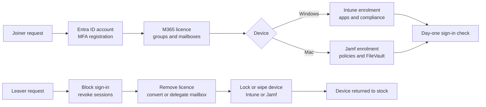

# Project 08 — Identity & Endpoint Lifecycle (Entra ID, Microsoft 365, Intune, Jamf)

## Executive summary

Delivered day-to-day identity and endpoint administration for staff in an
enterprise EMEA IT operations team, across both Windows and macOS. Work covered
the full joiner, mover and leaver lifecycle: creating and disabling accounts in
Microsoft Entra ID, password and MFA resets, Microsoft 365 licences and group
membership, preparing and enrolling laptops through Microsoft Intune and Jamf,
and locking, wiping and recovering devices when people left. User-facing support
for Outlook, Teams and other Microsoft 365 services ran alongside the
administration work.

## Operational challenge

A new starter needs a working identity, the right access and a secure, ready
laptop on day one. A leaver needs all of that removed quickly and completely.
When identity and device steps are handled separately or from memory, people
start without access, keep access after leaving, or devices go missing from
management. Two operating systems with two management platforms make that gap
wider.

## My contribution

**Identity and access (Microsoft Entra ID / Microsoft 365)**

- Created user accounts for new starters and disabled accounts for leavers.
- Reset passwords and re-registered or reset MFA methods for users who had
  lost or changed their phone, after verifying identity.
- Assigned Microsoft 365 licences and added users to security groups,
  distribution lists and shared mailboxes based on role.
- Supported users with Outlook, Teams, OneDrive and sign-in issues.

**Endpoints (Microsoft Intune / Jamf / Apple)**

- Prepared Windows and Mac laptops for new starters and enrolled them into
  management.
- Used the Intune admin centre to check device status, trigger syncs, review
  compliance and confirm required apps had installed.
- Used Jamf Pro to check Mac inventory and check-in status, run policies and
  send lock or wipe commands.
- Locked and wiped devices for leavers and lost-device cases, and returned
  recovered devices to stock for redeployment
  (see [Project 04](../04-asset-return-redeployment/README.md)).

## Approach — one lifecycle, two platforms



- **Identity first.** The Entra ID account and its groups decide what a person
  can reach, so access is granted by group membership rather than one-off
  permissions.
- **MFA is a security event.** Resets were only done after confirming the
  user's identity, because an MFA reset is a common target for social
  engineering.
- **Same outcome on both platforms.** Intune for Windows and Jamf for macOS
  apply equivalent controls: required apps, encryption (BitLocker / FileVault),
  updates and compliance.
- **Leavers in a fixed order.** Sign-in is blocked and sessions revoked before
  anything else, so access ends at once; licences, mailbox and device follow.

## Outcomes

- New starters received a managed laptop and working access through a
  consistent sequence of identity and device steps.
- Leaver access was removed in a defined order, and devices were locked or
  wiped and brought back into stock.
- Support covered both Windows and macOS users with the same standard.

## Technologies and competencies

- Microsoft Entra ID (users, groups, MFA, sign-in)
- Microsoft 365 (licences, Exchange Online mailboxes, Teams, OneDrive)
- Microsoft Intune (enrolment, compliance, app deployment, remote actions)
- Jamf Pro (Mac inventory, policies, lock and wipe)
- Windows and macOS end-user support
- Joiner / mover / leaver (JML) process

## Public demonstration artefacts

- [`joiner-leaver-runbook.md`](joiner-leaver-runbook.md) — a generic,
  step-by-step joiner and leaver runbook covering Entra ID, Microsoft 365,
  Intune and Jamf.
- [`troubleshooting-guide.md`](troubleshooting-guide.md) — common identity and
  device issues, how they were diagnosed, and the fix.
- [`Get-UserAccessSnapshot.ps1`](Get-UserAccessSnapshot.ps1) — a **read-only**
  Microsoft Graph PowerShell script that reports one user's account state,
  licences, groups, MFA methods and Intune-managed devices. It makes **no**
  changes and is useful as a check before and after a joiner or leaver.

> **Important:** these artefacts are **sanitised reference implementations**
> written for portfolio purposes. They are not the original enterprise
> procedures or tooling, and contain no tenant names, domains, user data or
> internal configuration.

### Running the script

Requires the Microsoft Graph PowerShell SDK and read permissions in a tenant
you are authorised to query.

```powershell
Install-Module Microsoft.Graph -Scope CurrentUser
pwsh -File ./Get-UserAccessSnapshot.ps1 -UserPrincipalName jane.doe@contoso.com
```

## Related work

[Project 07](../07-jira-service-management-lab/README.md) turns this same
lifecycle into Jira Service Management requests: the onboarding and offboarding
flows create one sub-task per identity and device step described here.

## Security and confidentiality considerations

- No tenant, domain, user or device details from any employer are included.
- Examples use Microsoft's fictional `contoso.com` domain.
- The script only reads data through delegated Graph permissions.
