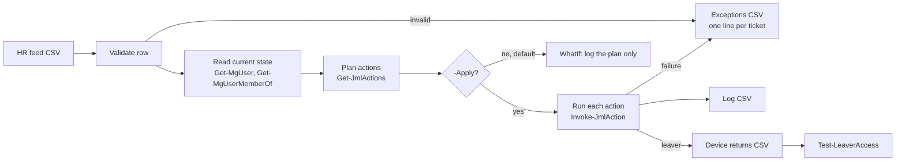

# Project 09 — Joiner, Mover and Leaver Automation with Microsoft Graph PowerShell (lab, tested with Pester)

> **Lab with synthetic data. No Microsoft tenant is used.** Every Microsoft
> Graph and Exchange Online call is replaced by a Pester mock. To run this for
> real you need a Microsoft 365 tenant, the permissions listed below and a
> test run with `-WhatIf` first.

## Executive summary

At TikTok (IT Operations Engineer, Dublin, EMEA, March 2023 to September 2026)
I did joiner and leaver steps by hand in Microsoft Entra ID and Microsoft 365:
creating and disabling accounts, assigning licences, adding people to security
groups, distribution lists and shared mailboxes, and then the device wipe and
return. This lab shows how I would automate those steps with Microsoft Graph
PowerShell: a PowerShell module that reads an HR feed (CSV), plans the actions
for each person, runs them with `-WhatIf` by default, turns failures into a
ticket list, and checks afterwards that leavers have lost access.

What I did **not** do at TikTok: build an HR integration or administer Intune.
Both are outside what I claim here.

## What it does



| Function | What it does |
|---|---|
| `Get-JmlActions` | Takes one HR row and the account as it is now; returns the ordered list of actions. Pure function, no Graph calls. |
| `Invoke-JmlAction` | Runs one action with Microsoft Graph (or Exchange Online where Graph cannot do it). Supports `-WhatIf`. Returns a log object. Never prints or logs the password. |
| `Invoke-JmlRun` | Reads the HR CSV, plans and runs every row. Dry run unless `-Apply` is given. One failure does not stop the run. |
| `Test-LeaverAccess` | Read-only check that a leaver is disabled and is no longer a member of any group. |

### The HR feed

`sample-data/hr-feed.csv` has five synthetic people:

| Person | Status | What the lab plans |
|---|---|---|
| Jane Doe | Joiner (Finance, IE) | Create account, usage location IE, manager, `SG-Dept-Finance`, `LIC-M365-BusinessPremium` |
| Aoife Murphy | Mover (Sales to Finance) | Update department and job title, add `SG-Dept-Finance`, remove `SG-Dept-Sales`, keep the licence and distribution lists |
| Liam Byrne | Leaver | Block sign-in, revoke sessions, convert mailbox to shared, remove licence group, remove groups and distribution lists, raise a device return |
| Sara Costa | Joiner (Engineering, PT) | Same as Jane, with usage location PT |
| John Smith | Invalid row (no EmployeeId) | Rejected and written to the exceptions CSV |

Columns: `EmployeeId, DisplayName, Department, JobTitle, Manager, StartDate,
EndDate, Status, Country`. Dates use `yyyy-MM-dd`; `Country` is a two-letter
ISO code; `Status` is `Joiner`, `Mover` or `Leaver`.

### Groups and licences

Access comes from groups only, never from one-off grants:

- one department security group per department: `SG-Dept-<Department>`;
- one licence group with **group-based licensing**: `LIC-M365-BusinessPremium`.
  The licence is attached to the group once in the Entra admin centre; adding
  or removing a person from the group adds or removes the licence;
- distribution lists (`DL-*`) are left alone for joiners and movers (they are
  requested separately) and removed for leavers.

### Order of actions

| Joiner | Mover | Leaver |
|---|---|---|
| 1. Create account | 1. Update department and job title | 1. **Block sign-in** |
| 2. Set usage location (before the licence) | 2. Add new department group | 2. **Revoke sessions** |
| 3. Set manager | 3. Remove old department group | 3. Convert mailbox to shared (before the licence goes) |
| 4. Add department group | 4. Set manager | 4. Remove licence group |
| 5. Add licence group | | 5. Remove security groups |
| | | 6. Remove distribution lists |
| | | 7. Raise device return |

- A joiner that already has an account is not created twice; only the missing
  steps are planned.
- A leaver is only processed on or after the `EndDate`.
- If one action fails, the remaining steps for **that person** stop (a group
  add needs the account first) and the run moves on to the next person.

## Manual step at TikTok and the automated action here

| Manual step I did at TikTok | Automated action in this lab | Cmdlet |
|---|---|---|
| Create the account in Entra ID | `CreateUser` | `New-MgUser` (random password, never shown; change forced at first sign-in) |
| Set the usage location so a licence can be assigned | `SetUsageLocation` | `Update-MgUser -UsageLocation` |
| Assign the Microsoft 365 licence | `AssignLicenceGroup` (group-based licensing) | `New-MgGroupMember` |
| Add to role security groups | `AddToGroup` | `New-MgGroupMember` |
| Change groups when someone moves team | `AddToGroup` and `RemoveFromGroup` | `New-MgGroupMember`, `Remove-MgGroupMemberByRef` |
| Disable the account of a leaver | `BlockSignIn` | `Update-MgUser -AccountEnabled:$false` |
| Sign the leaver out everywhere | `RevokeSessions` | `Revoke-MgUserSignInSession` |
| Convert the leaver mailbox to a shared mailbox | `ConvertMailboxToShared` | `Set-Mailbox -Type Shared` (Exchange Online) |
| Remove the licence | `RemoveLicenceGroup` | `Remove-MgGroupMemberByRef` |
| Remove security groups and distribution lists | `RemoveFromGroup`, `RemoveFromDistributionList` | `Remove-MgGroupMemberByRef`, `Remove-DistributionGroupMember` (Exchange Online) |
| Device wipe and return | `RaiseDeviceReturnTicket` (hand-off only) | none: the device return CSV goes to the service desk |
| Check that the leaver has no access left | `Test-LeaverAccess` | `Get-MgUser`, `Get-MgUserMemberOf` |

Microsoft Graph cannot convert a mailbox or change distribution list
membership, so those two steps use the Exchange Online PowerShell module.

## How to run

### 1. Tests (no tenant needed)

Requires PowerShell 7 and Pester 5.5 or later. The Microsoft Graph modules are
**not** needed: the tests define stubs and mocks.

```powershell
Install-Module Pester -MinimumVersion 5.5 -Force -Scope CurrentUser
Invoke-Pester ./projects/09-identity-lifecycle-automation/tests -Output Detailed
```

### 2. In a tenant: WhatIf first

```powershell
Install-Module Microsoft.Graph.Users, Microsoft.Graph.Groups -Scope CurrentUser
Install-Module ExchangeOnlineManagement -Scope CurrentUser

Connect-MgGraph -Scopes 'User.ReadWrite.All', 'GroupMember.ReadWrite.All' -NoWelcome
Connect-ExchangeOnline -ShowBanner:$false

Import-Module ./projects/09-identity-lifecycle-automation/src/JmlLifecycle.psm1

# Dry run (default): nothing changes, the plan goes to the log CSV.
$run = Invoke-JmlRun -Path ./hr-feed.csv -OutputDirectory ./out
$run.Log | Format-Table Step, EmployeeId, Action, Target, Result

# Only after the plan has been read and agreed:
$run = Invoke-JmlRun -Path ./hr-feed.csv -OutputDirectory ./out -Apply

# Then check each leaver.
Test-LeaverAccess -UserId liam.byrne@contoso.com
```

Output files in `-OutputDirectory` (paths with spaces are fine):

| File | Written when | Contents |
|---|---|---|
| `jml-log-<time>.csv` | always | every action and its result (`WhatIf`, `Done`, `Failed`, `Rejected`, `Skipped`, `Handoff`) |
| `jml-exceptions-<time>.csv` | rejected rows or failed actions | one line per ticket (see below) |
| `jml-device-returns-<time>.csv` | a leaver was processed with `-Apply` | who must return a device |

## Required permissions (least privilege)

Delegated Microsoft Graph scopes:

| Scope | Why |
|---|---|
| `User.ReadWrite.All` | Create users, set usage location, department, job title and manager, block sign-in, revoke sessions, read the current state and memberships |
| `GroupMember.ReadWrite.All` | Find groups by name and add or remove members of security and licence groups |

Not needed and not requested: `Directory.ReadWrite.All`,
`Group.ReadWrite.All`, any Intune scope.

Directory roles for the person who runs it:

- **User Administrator** in Entra ID (not Global Administrator). It cannot
  change administrators or role-assignable groups, which is intended: those
  stay manual.
- **Exchange Recipient Administrator** for the mailbox conversion and
  distribution list removal.

For an unattended scheduled run, the same permissions would be granted as
application permissions to an app registration that signs in with a
certificate, not a client secret. That is design only in this lab.

## Approvals that stay with people

Automation does the routine part. These decisions stay manual on purpose:

- **Access outside the role.** The lab only grants the department group and
  the standard licence. Anything else (a shared mailbox, an extra app, admin
  rights) goes through the access request with **manager approval**, as in
  the [Jira Service Management lab](../07-jira-service-management-lab/README.md).
- **"Disable now".** An urgent leaver (for example a dismissal) does not wait
  for the HR feed. The service desk blocks sign-in and revokes sessions by
  hand in the Entra admin centre, following the
  [joiner and leaver runbook](../08-identity-endpoint-lifecycle/joiner-leaver-runbook.md).
  The next run then finds the account already disabled and completes the
  tidy-up.
- **The first `-Apply`.** The dry-run plan is read before anything changes.
- **Day-one sign-in.** The account gets a random password that nobody sees.
  The new starter signs in with a Temporary Access Pass issued by the service
  desk after checking their identity.

## How failures become a ticket

Every rejected row and every failed action becomes one line in
`jml-exceptions-<time>.csv`:

`Timestamp, Row, EmployeeId, DisplayName, Status, Manager, FailedAction,
Target, Reason, TicketPriority, TicketSummary`

- `TicketSummary` is ready to use as the ticket title, for example
  `JML exception: Joiner Jane Doe (E1001) - CreateUser failed`.
- A leaver failure is **High** priority, because the person may still have
  access. Everything else is Medium.
- In the [Jira Service Management lab](../07-jira-service-management-lab/README.md)
  each line maps to a request in the IT service space, so the service desk can
  pick it up from a queue with an SLA. Creating the tickets automatically
  (import or API) is a next step; it is not built here.

## Tests

`tests/JmlLifecycle.Tests.ps1` (Pester 5 syntax) covers:

- planning for each status (joiner, mover, leaver) and a re-run of a joiner;
- the mover group difference (add new department group, remove the old one,
  keep the licence and distribution lists);
- leaver order: block sign-in and revoke sessions **first**, mailbox before
  licence;
- `-WhatIf` makes no Graph or Exchange call (`Should -Invoke -Times 0`);
- a failed action is logged as an exception and the run continues with the
  next person; a failed leaver is High priority;
- invalid rows are rejected (missing EmployeeId, unknown status, bad date or
  country, an EmployeeId that would break the Graph filter);
- the password is never written to the log;
- `Test-LeaverAccess` passes and fails as expected.

CI runs the same tests on `ubuntu-latest` with PowerShell 7
(`.github/workflows/validate.yml`, job `pester`).

## Limits

- **Lab only, no tenant.** The Graph and Exchange calls are checked against
  mocks, not against Microsoft 365. Parameter names follow the Microsoft Graph
  PowerShell SDK v2; a real tenant run is needed to confirm behaviour.
- **Intune device wipe is new to me — design only.** At TikTok I did device
  wipe and return by hand, and I did not administer Intune. Here the device
  step is a hand-off to the service desk, not an Intune remote wipe.
- **No HR integration.** The HR feed is a CSV file. A real setup would take
  the feed from the HR system; that is not built here.
- Shared mailbox access for joiners is not automated (it needs owner
  approval).
- User principal names are built as `first.last@contoso.com`; name clashes
  are not handled and would show up as a failed `CreateUser`.
- Group changes and session revocation can take a few minutes to apply in
  Microsoft 365; run `Test-LeaverAccess` after that.

## Related work

- [Project 08](../08-identity-endpoint-lifecycle/README.md): the manual
  lifecycle this lab automates, the joiner and leaver runbook, and a
  read-only access snapshot script.
- [Project 07](../07-jira-service-management-lab/README.md): onboarding and
  offboarding requests, access approval and laptop return in Jira Service
  Management.
- [Project 04](../04-asset-return-redeployment/README.md): what happens to the
  returned device.

## Security and confidentiality considerations

- All people, groups and dates are synthetic. Examples use Microsoft's
  fictional `contoso.com` domain.
- No tenant, domain, user or device details from any employer are included.
- The temporary password is created in memory and never printed or logged; the
  log only records what was done to whom.
- `EmployeeId` is validated before it is used in a Graph filter.
