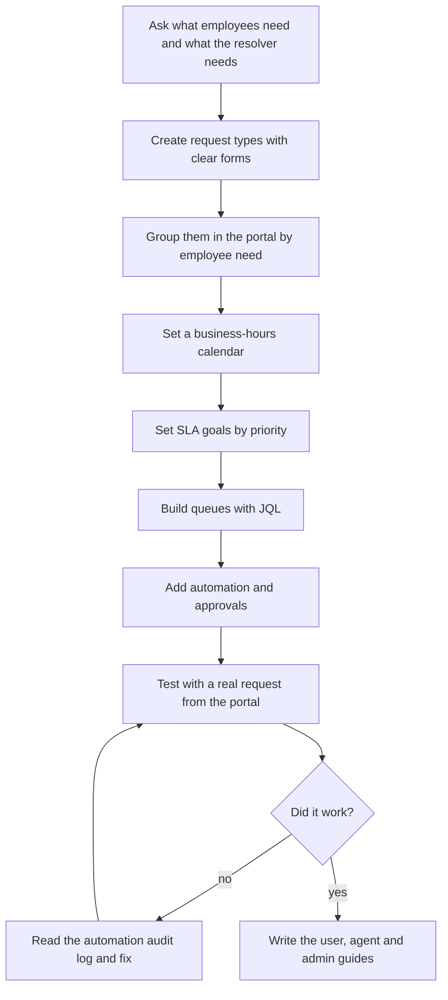
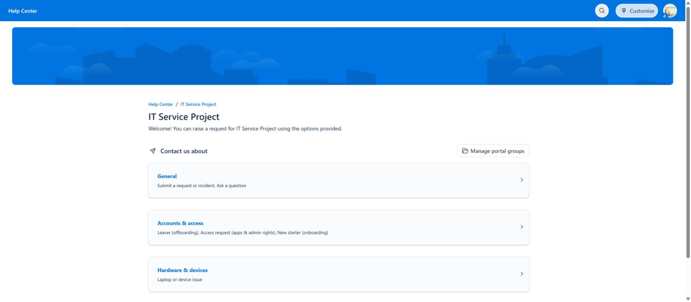
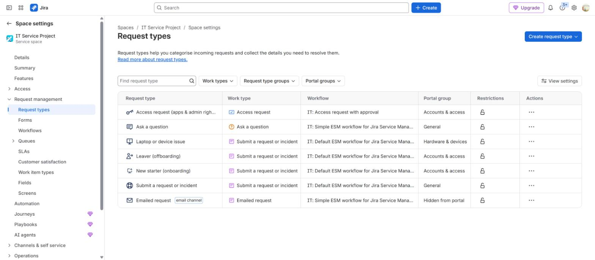
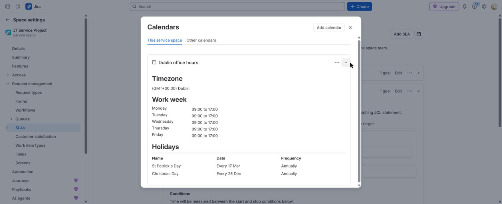
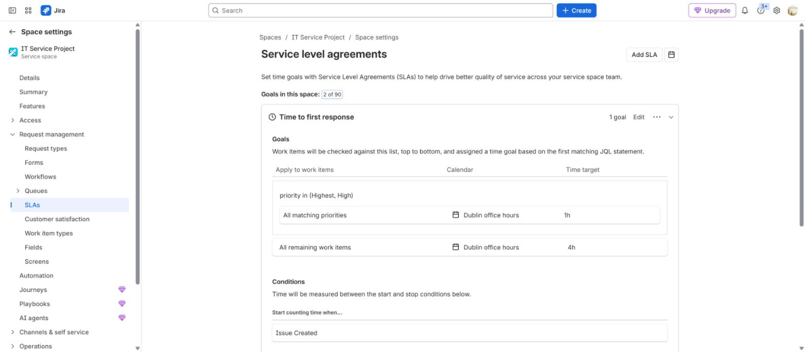
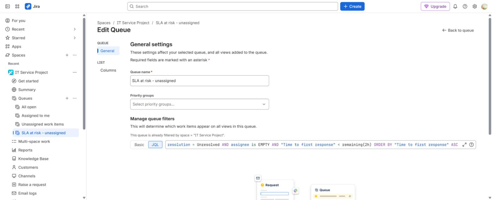
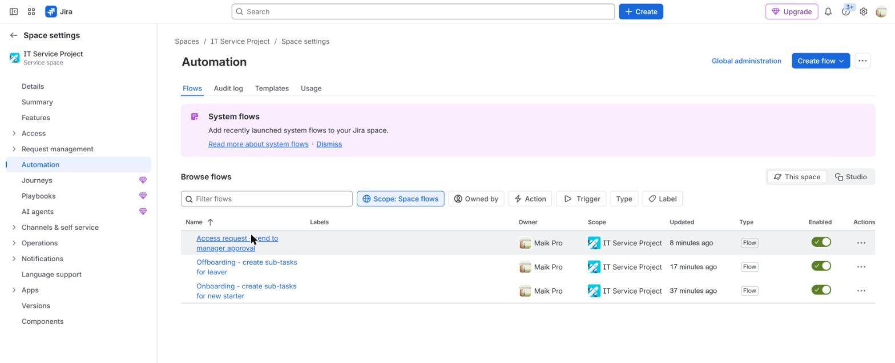
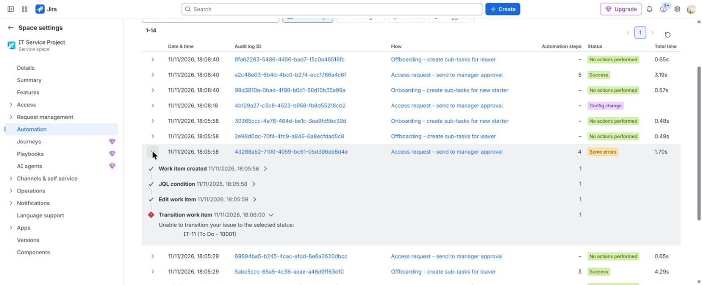

# Jira Service Management admin

**The situation:** A company runs its IT service desk on Jira Service Management. It needs someone who can change the setup: request types, SLAs, queues, automation and approvals.

## What I did in real work

At TikTok I used Jira every day as an agent, not as an admin. I set priorities,
owned L2 and L3 escalations, worked to SLAs and wrote runbooks in Lark.

To learn the admin side, I built my own Jira Service Management site and
configured it from the start. The proof on this page comes from that lab site.

## The process I follow

1. Ask what employees need and what the person who resolves the ticket needs to know.
2. Create one request type per need, with a form that asks for those details.
3. Group the request types in the portal by what the employee needs, not by how IT sorts work.
4. Set a calendar with the real office hours and public holidays.
5. Set SLA goals by priority, with a catch-all goal last.
6. Build queues with JQL so agents see the most urgent work first.
7. Add automation for repeat steps and approvals for access.
8. Raise a real test request through the portal.
9. If the result is wrong, open the automation audit log, find the failed step and fix it.
10. Write short guides for users, agents and admins.

## Proof

- [Build log, Steps 1 to 15](../projects/07-jira-service-management-lab/build-log.md)
- [Build log, Step 9: testing and troubleshooting](../projects/07-jira-service-management-lab/build-log.md#step-9--testing-and-troubleshooting)
- [Admin guide](../projects/07-jira-service-management-lab/manuals/admin-guide.md)
- [Agent runbook](../projects/07-jira-service-management-lab/manuals/agent-runbook.md)
- [User guide](../projects/07-jira-service-management-lab/manuals/user-guide.md)
- [Phase 5: permission, notification and workflow schemes](../projects/07-jira-service-management-lab/admin/phase-5-administration.md)
- [Test results](../projects/07-jira-service-management-lab/evidence/owner-cloud-results.md)

## Tools

- Jira Service Management Cloud, JQL, Jira automation, Assets, Confluence knowledge base
- Not configured in the lab: SAML SSO and SCIM from Entra ID. They are a next step.

---

Lab work uses synthetic data. No employer data is published.
