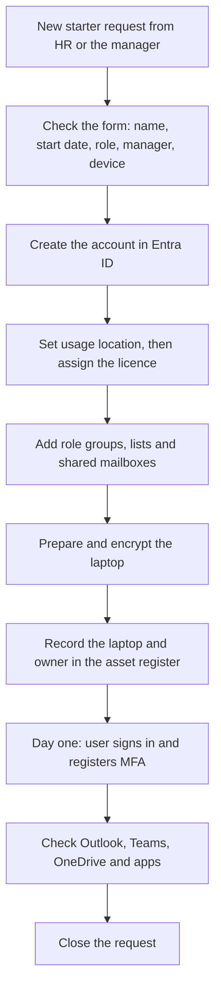
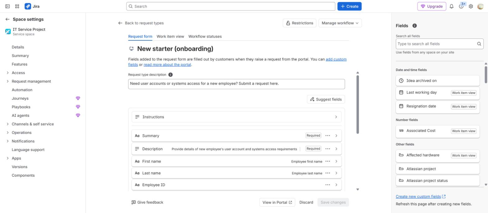
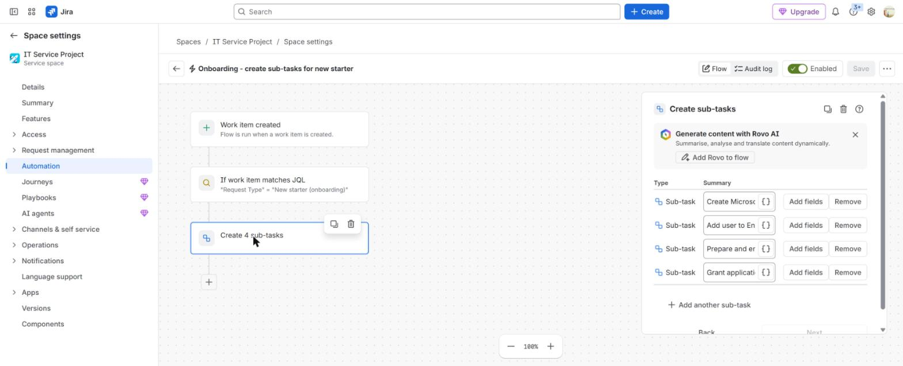
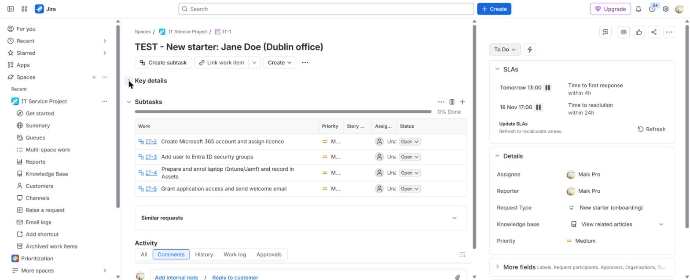

# New starter process

**The situation:** HR tells IT that a new person starts next Monday. On day one they need an account, the right access and a ready laptop.

## What I did in real work

At TikTok I handled joiners in Entra ID and Microsoft 365. I created accounts,
reset passwords and MFA, assigned licences, and added people to security
groups, distribution lists and shared mailboxes. I prepared Mac laptops with
Apple Business Manager and Puppet, and Windows laptops with BitLocker. I
applied the laptop image with MCU and checked each machine against a hardware
checklist before handover.

I also worked daily in an internal ITAM system, which was the record of truth
for equipment. I looked up and updated user records, added new laptops to the
inventory, and set the asset to the user at handover. When a device came back
I updated the same record, so the inventory matched what people actually held.
A joiner or leaver was not finished for me until that record was correct.

## The process I follow

1. Receive the New starter request from HR or the manager.
2. Check the form has the name, start date, role, manager and device type.
3. Create the account in Entra ID with the standard name format.
4. Set the usage location.
5. Assign the Microsoft 365 licence.
6. Add the person to the security groups and distribution lists for the role.
7. Give shared mailbox access if the owner approved it.
8. Prepare the laptop. Mac: Apple Business Manager and Puppet. Windows: standard build and BitLocker.
9. Record the laptop and its owner in the asset register. At TikTok this was an internal ITAM system; in my lab it is Jira Assets.
10. On day one, the user signs in and registers MFA.
11. Check Outlook, Teams, OneDrive and the required apps with the user.
12. Close the request.

## The asset record: real work and my lab

At TikTok the equipment record lived in an internal ITAM system, and I used it
as described above. I could not take that system with me, so in my own lab I
rebuilt the same idea in Jira Assets to learn how to configure and administer
it rather than only use it.

In the lab I created an object schema with one object type for laptops and one
for people, and linked each laptop to the person holding it. The new starter
request reads the laptop field from Assets, so the agent picks a real object
instead of typing a model name by hand. When the ticket closes, the automation
sets the status to **In use** and fills in the holder. The leaver request
reverses it: status back to **Returned**, holder cleared.

Example objects from the lab. These are invented for the lab and are not real
people or real devices:

| Asset tag | Model | Status | Assigned to |
|---|---|---|---|
| LAB-0001 | MacBook Pro 14 | In use | Aoife Byrne |
| LAB-0002 | Dell Latitude 5440 | In stock | unassigned |
| LAB-0003 | MacBook Air 13 | Returned | unassigned |

This gives the same check I relied on at TikTok: the onboarding ticket cannot
close while the asset record still says the laptop is in stock.

## Proof

- [Build log, Step 2: request forms](../projects/07-jira-service-management-lab/build-log.md#step-2--request-types-and-request-forms)
- [Build log, Step 6: onboarding automation](../projects/07-jira-service-management-lab/build-log.md#step-6--onboarding-automation-joiner)
- [Joiner and leaver runbook](../projects/08-identity-endpoint-lifecycle/joiner-leaver-runbook.md)
- [Read-only access check: Get-UserAccessSnapshot.ps1](../projects/08-identity-endpoint-lifecycle/Get-UserAccessSnapshot.ps1)
- [Joiner automation with Microsoft Graph PowerShell](../projects/09-identity-lifecycle-automation/README.md)

## Tools

- Entra ID, Microsoft 365, Apple Business Manager, Puppet, BitLocker, Jira Service Management
- Imaging and build validation: MCU and a hardware checklist at TikTok
- Asset register: an internal ITAM system at TikTok, Jira Assets in my lab
- Familiar: same process, different system. Intune, Jamf and Mosyle for device enrolment. SSO and SCIM for app accounts.

---

**Author:** Marcus Paula

Lab work uses synthetic data. No employer data is published.
