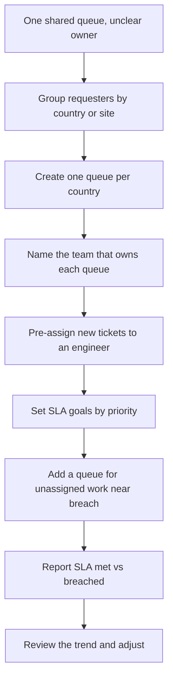
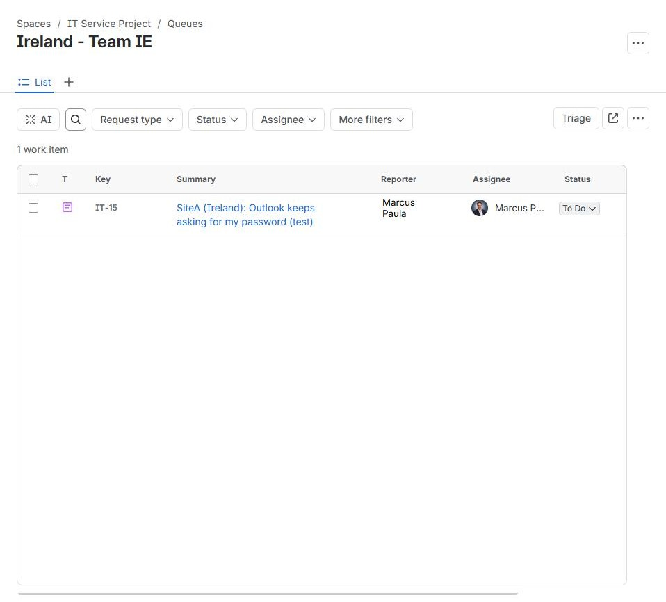
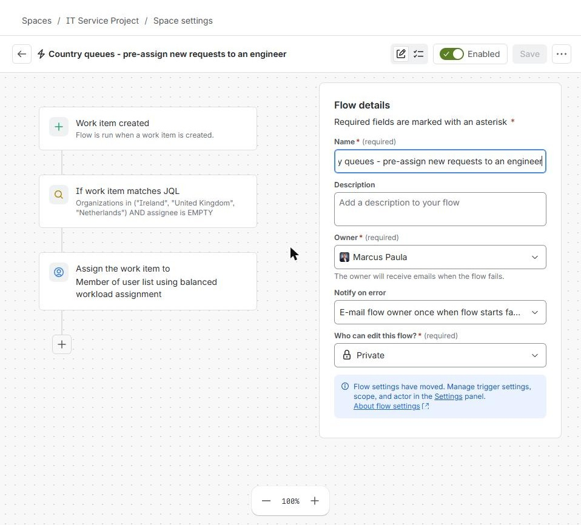
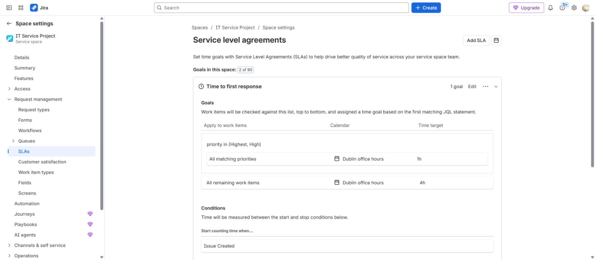
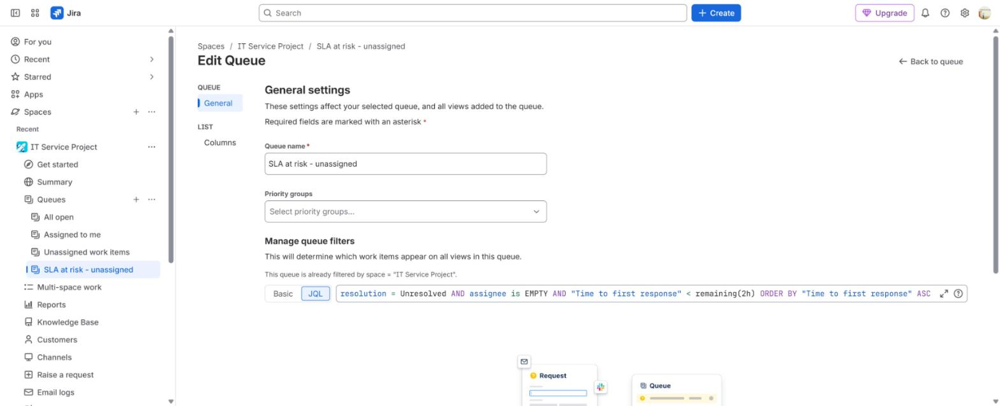
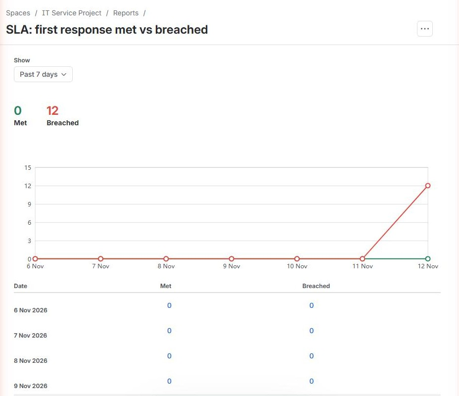
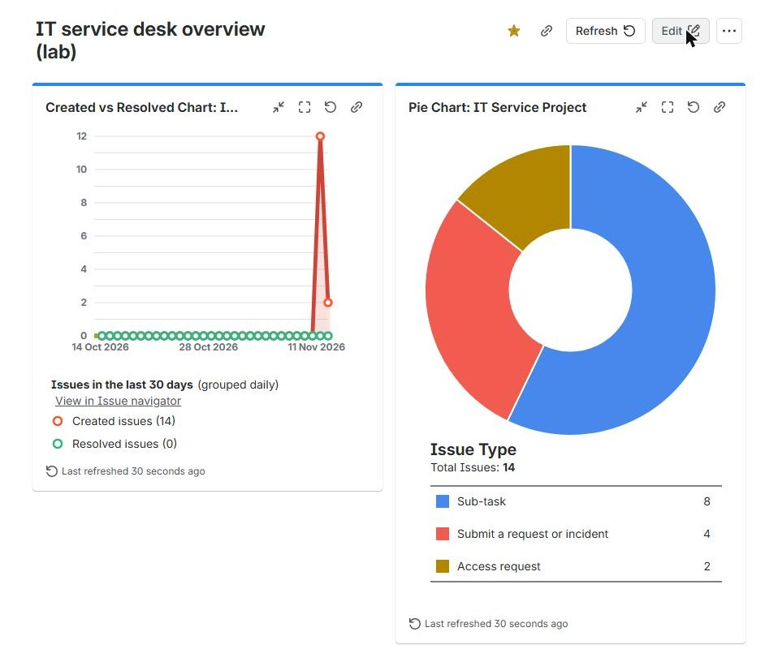

# Service desk backlog and routing

**The situation:** Every ticket lands in one shared queue. Nobody is sure who owns what, and the backlog grows.

## What I did in real work

When I started at TikTok, all tickets went to one queue. Later the queue was
split by country. Each country queue had a responsible team. Tickets were
routed and pre-assigned to the technician, and SLAs were set by priority.
After that, tickets were answered faster and ownership was clear.

## The process I follow

1. Look at the shared queue and list where the tickets come from.
2. Group requesters by country or site.
3. Create one queue per country.
4. Name the team that owns each queue.
5. Pre-assign each new ticket to an engineer. Balance the workload.
6. Set SLA goals by priority.
7. Add a queue that shows unassigned tickets close to breach.
8. Report SLA met vs breached every week.
9. Use the trend to change staffing or routing.

## Proof

- [Build log, Step 15: country queues and pre-assignment, tests IT-15, IT-16 and IT-17](../projects/07-jira-service-management-lab/build-log.md#step-15)
- [Build log, Step 4: SLAs](../projects/07-jira-service-management-lab/build-log.md#step-4--slas-goals-and-conditions)
- [Build log, Step 5: queue with JQL](../projects/07-jira-service-management-lab/build-log.md#step-5--queue-with-jql)
- [Build log, Step 14: report and dashboard](../projects/07-jira-service-management-lab/build-log.md#step-14--reports-and-dashboard)
- [Agent runbook: triage](../projects/07-jira-service-management-lab/manuals/agent-runbook.md#1-triage)
- [Phase 5: one service desk for three companies](../projects/07-jira-service-management-lab/admin/phase-5-administration.md#4-design-one-group-it-service-desk-for-three-companies)

## Tools

- Jira Service Management: organizations, queues, JQL, automation, reports, dashboards

---

Lab work uses synthetic data. No employer data is published.
