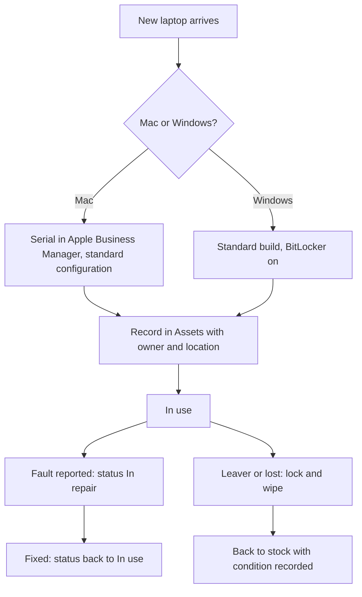
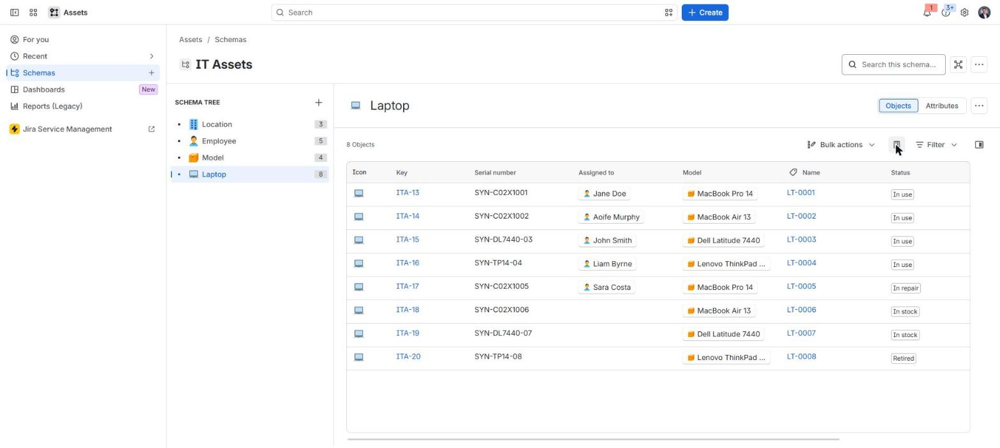
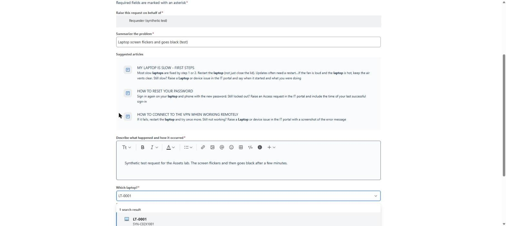
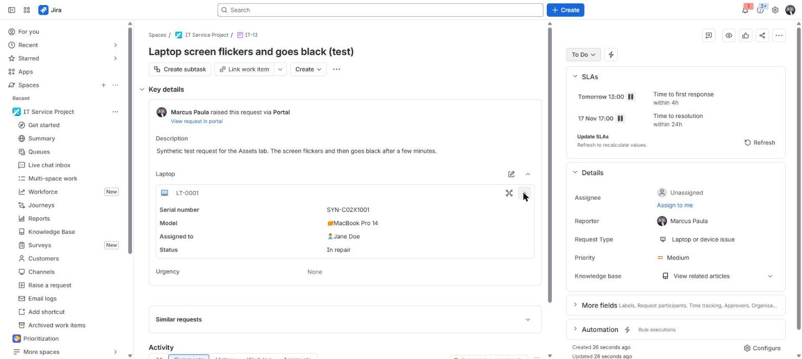
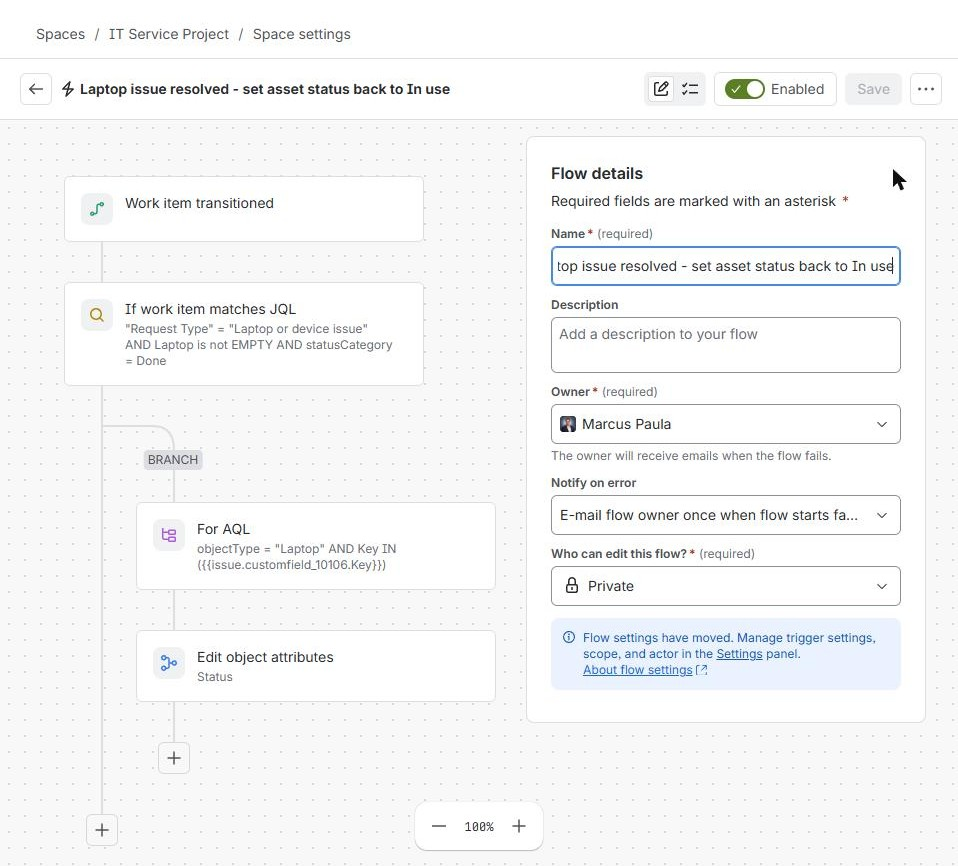
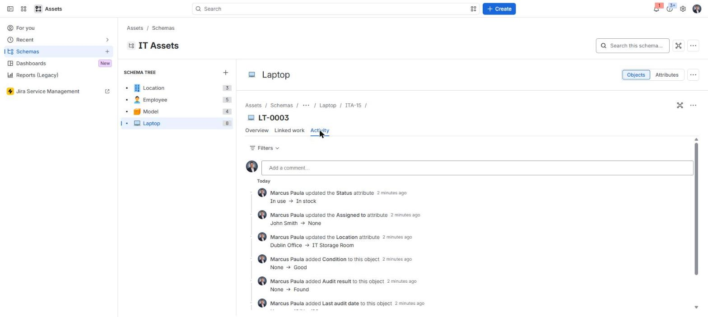

# Mac and Windows device management

**The situation:** A company has Mac and Windows laptops. Each one must be enrolled, configured, encrypted and tracked, and wiped when it comes back.

## What I did in real work

At TikTok I managed Macs with Apple Business Manager and Puppet, and Windows
laptops with BitLocker and MBAM. I locked and wiped devices, and processed
returns. I worked on the asset return process in three sites. I also cut
imaging time from 60 to 15 minutes per device
([scenario 15](15-process-improvement-imaging.md)).

## The process I follow

1. Receive the new laptop.
2. Mac: check the serial is in Apple Business Manager, then apply the standard configuration.
3. Windows: install the standard build and turn on BitLocker.
4. Record the laptop in Assets with owner, location, encryption and the tool that manages it.
5. Hand it over. The status is In use.
6. When a fault is reported, set the status to In repair.
7. When the fix is done, set the status back to In use.
8. For a leaver or a lost laptop, lock it first, then wipe it.
9. Put the returned laptop back in stock and record its condition.

## Proof

- [Project 08: tool mapping to Intune and Jamf](../projects/08-identity-endpoint-lifecycle/README.md#tool-mapping)
- [Troubleshooting guide](../projects/08-identity-endpoint-lifecycle/troubleshooting-guide.md)
- [Build log, Step 11: Assets](../projects/07-jira-service-management-lab/build-log.md#step-11--assets-laptops-linked-to-requests)
- [Build log, Step 15: laptop back to In use](../projects/07-jira-service-management-lab/build-log.md#step-15)
- [Project 04: asset return workflow](../projects/04-asset-return-redeployment/README.md)
- [Read-only endpoint check: Get-EndpointReadiness.ps1](../projects/01-endpoint-imaging-optimisation/Get-EndpointReadiness.ps1)

## Tools

- Apple Business Manager, Puppet, BitLocker, MBAM, Jira Service Management Assets
- Familiar: same process, different system. Intune, Jamf and Mosyle (enrol, configure, encrypt, lock, wipe).

---

Lab work uses synthetic data. No employer data is published.
