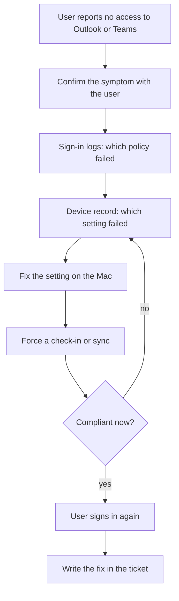

# Non-compliant Mac loses Microsoft 365 access

**The situation:** A user on a Mac cannot open Outlook or Teams. The sign-in page says the device does not meet the company's requirements.

## What I did in real work

At TikTok I supported Entra ID and Microsoft 365 sign-in problems. I worked
with Macs managed by Apple Business Manager and Puppet, and Windows laptops
with BitLocker and MBAM. Device compliance in Intune or Jamf was not my tool
there. The process is the same: find the check that failed, fix the device,
then sign in again.

## The process I follow

1. Confirm the symptom with the user. Note the app, the time and the error text.
2. Open the Entra ID sign-in logs and find the policy that failed.
3. Open the device record and find the setting that failed. Common causes are encryption off, an old OS version or a device that has not checked in.
4. Fix that setting on the Mac.
5. Force a check-in or sync from the management tool.
6. Check the device is compliant now.
7. Ask the user to sign in again.
8. Write the cause and the fix in the ticket. If it repeats, write a knowledge base article.

Do not exclude the user from the policy to make the error go away. Fix the cause.

## Proof

Process only, no screenshot in the lab for this tool. The closest proof:

- [Troubleshooting guide: sign-in blocked by Conditional Access, device not compliant, Mac not checking in](../projects/08-identity-endpoint-lifecycle/troubleshooting-guide.md)
- [Read-only script that shows a user's managed devices and their compliance state: Get-UserAccessSnapshot.ps1](../projects/08-identity-endpoint-lifecycle/Get-UserAccessSnapshot.ps1)
- [Project 08: tool mapping to Intune and Jamf](../projects/08-identity-endpoint-lifecycle/README.md#tool-mapping)
- How the user reports it in the lab: [laptop picker on the request form](../projects/07-jira-service-management-lab/screenshots/22-portal-laptop-picker.jpg) and [IT-13 with the laptop set to In repair](../projects/07-jira-service-management-lab/screenshots/24-test-IT-13-laptop-in-repair.jpg)

## Tools

- Entra ID sign-in logs, Microsoft 365, Apple Business Manager, Puppet
- Familiar: same process, different system. Intune and Jamf compliance, Mosyle.

---

Lab work uses synthetic data. No employer data is published.
