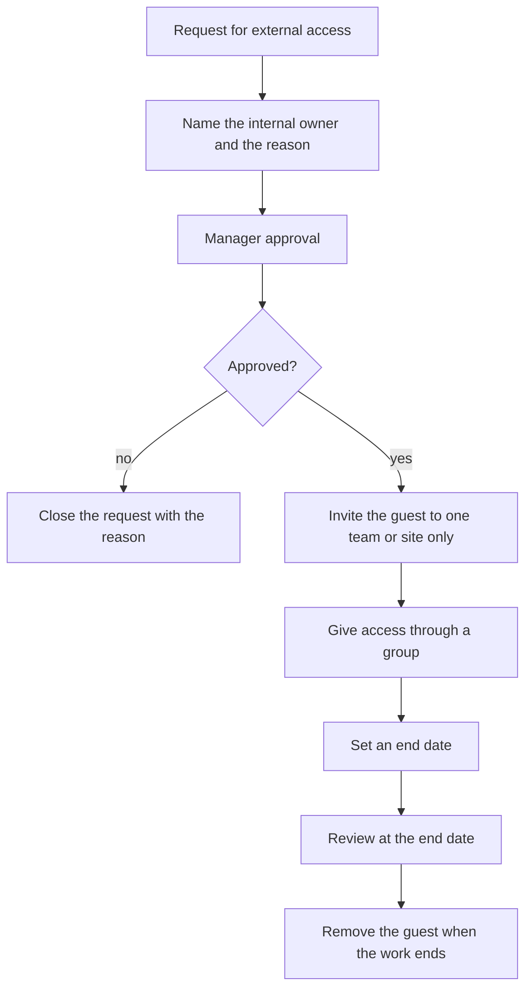
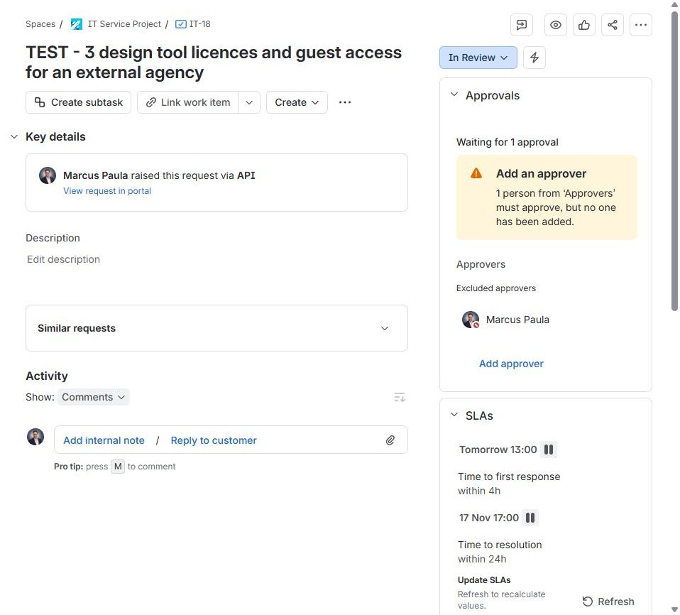
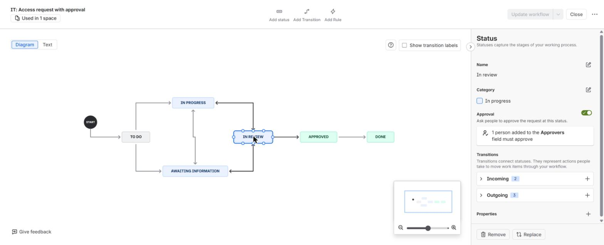
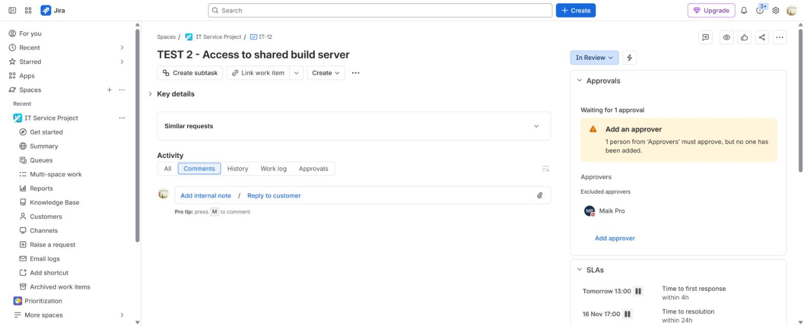

# External collaboration in Microsoft 365

**The situation:** A team wants to share files and a Teams channel with an outside partner. The company must control what is shared and for how long.

## What I did in real work

At TikTok I did not own the tenant sharing settings. I worked this with the
owning team. My part was the access around it: Microsoft 365 licences,
security groups, distribution lists and shared mailboxes, with access given
through groups.

## The process I follow

1. The employee raises a request for external access.
2. Record the internal owner, the partner and the business reason.
3. Send the request for manager approval. The requester cannot approve it.
4. If it is rejected, close the request and record the reason.
5. Invite the guest to one team or one site only, not to the whole tenant.
6. Give access through a group, so it is easy to review and remove.
7. Set an end date for the access.
8. At the end date, ask the owner if the access is still needed.
9. Remove the guest when the work ends.

## Proof

- [Build log, Step 15: SaaS licence or external guest access request](../projects/07-jira-service-management-lab/build-log.md#step-15)
- [Build log, Step 8: workflow and approvals](../projects/07-jira-service-management-lab/build-log.md#step-8--workflow-and-approvals)
- [Project 08: licences, groups and mailboxes](../projects/08-identity-endpoint-lifecycle/README.md)

The Microsoft 365 sharing settings are not in the lab.

## Tools

- Entra ID guest users, Microsoft 365 groups, Teams, SharePoint, Jira Service Management approvals
- Familiar: same process, different system. At TikTok we used Lark. Guest access in similar apps such as Teams, Slack and Miro follows the same process.

---

Lab work uses synthetic data. No employer data is published.
