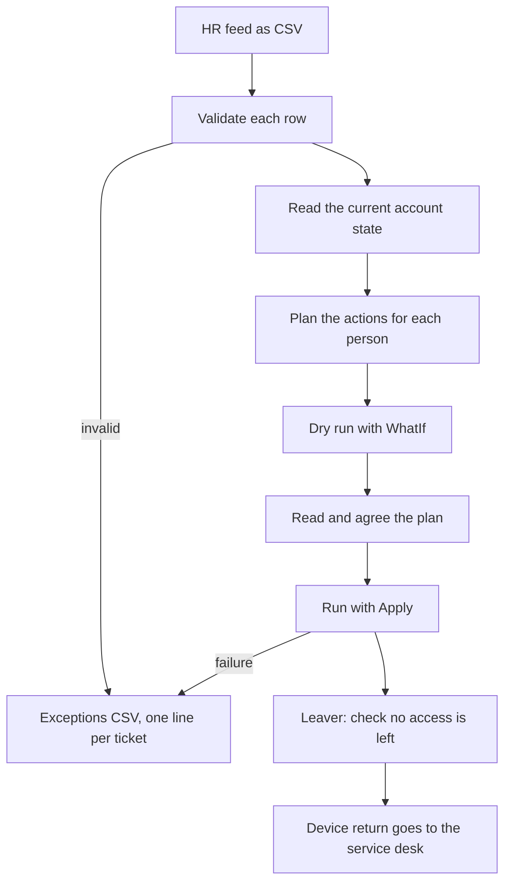
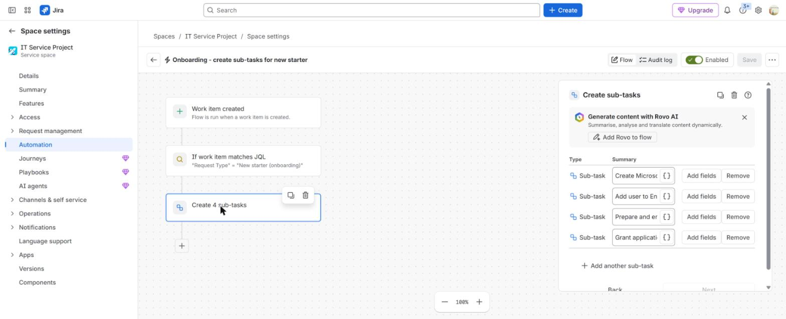
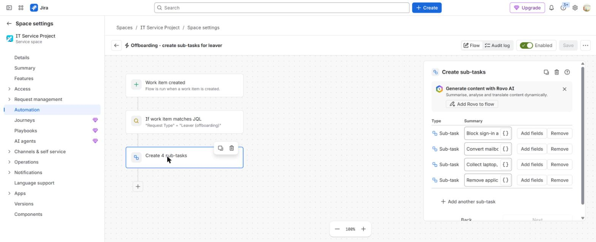
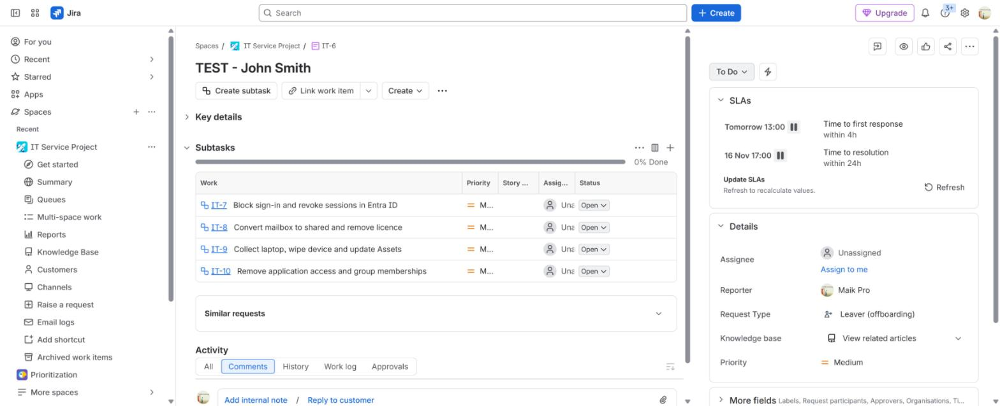

# Joiner, mover and leaver automation

**The situation:** IT creates and removes accounts by hand from HR emails. Steps get missed, and some leavers keep access.

## What I did in real work

At TikTok I ran joiner and leaver steps in Entra ID and Microsoft 365, and the device steps with Apple Business Manager, Puppet and BitLocker / MBAM.
I created and disabled accounts, reset passwords and MFA, assigned licences,
and managed security groups, distribution lists and shared mailboxes. For
devices I did the lock, wipe and return with Apple Business Manager and Puppet
for Macs, and BitLocker and MBAM for Windows.

In a lab I automated the same steps with Microsoft Graph PowerShell. I did not
build an HR integration at TikTok.

## The process I follow

1. Take the HR feed as a CSV file.
2. Validate each row. Send bad rows to the exceptions file.
3. Read the current state of each account.
4. Plan the actions. Joiner: create, usage location, manager, groups, licence. Mover: add the new group, remove the old one. Leaver: block sign-in and revoke sessions first.
5. Run a dry run with `-WhatIf`. Nothing changes.
6. Read the plan and agree it.
7. Run with `-Apply`.
8. Turn every failure into one line in the exceptions file. A leaver failure is High priority.
9. For each leaver, run the access check.
10. Send the device return list to the service desk.

Urgent leavers do not wait for the feed. The service desk blocks sign-in by hand.

## Proof

- [Project 09: Graph PowerShell module and how to run it](../projects/09-identity-lifecycle-automation/README.md)
- [Project 09: module source](../projects/09-identity-lifecycle-automation/src/JmlLifecycle.psm1)
- [Project 09: 31 Pester tests with mocked Graph calls](../projects/09-identity-lifecycle-automation/tests/JmlLifecycle.Tests.ps1)
- [CI workflow that runs the tests](../.github/workflows/validate.yml)
- [Synthetic HR feed](../projects/09-identity-lifecycle-automation/sample-data/hr-feed.csv)
- [Joiner and leaver runbook](../projects/08-identity-endpoint-lifecycle/joiner-leaver-runbook.md)
- [Build log, Step 7: offboarding automation](../projects/07-jira-service-management-lab/build-log.md#step-7--offboarding-automation-leaver)
- [Active Directory automation repository](https://github.com/marcuspaula-seceng/active-directory-automation): onboard, transfer and offboard scripts for on-premises Active Directory, with Pester tests

## Tools

- Microsoft Graph PowerShell, Exchange Online PowerShell, Pester, GitHub Actions, Active Directory PowerShell
- Familiar: same process, different system. SSO and SCIM provisioning from Entra ID to SaaS apps.

---

Lab work uses synthetic data. No employer data is published.
