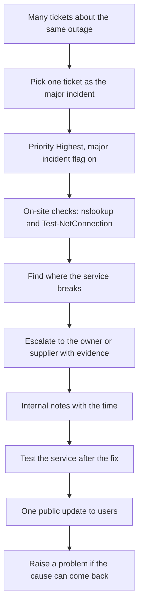
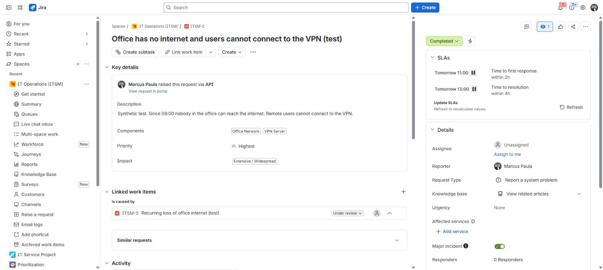
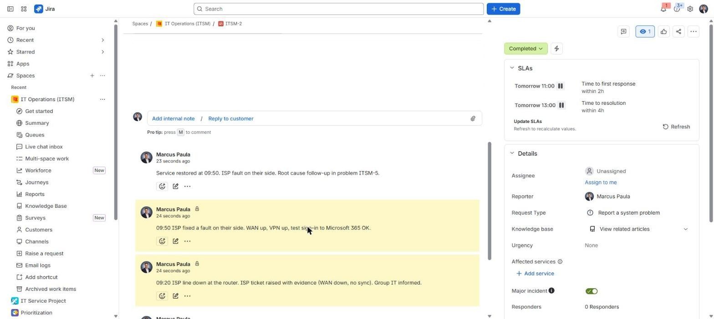
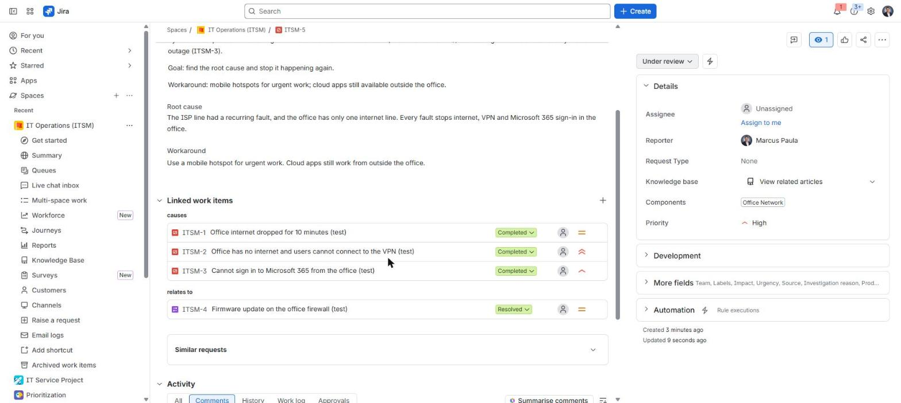

# Office internet outage: the first 60 minutes

**The situation:** At 09:00 the office loses internet. Nobody can connect to the VPN, and tickets start to arrive from many people.

## What I did in real work

At TikTok the firewall and VPN were owned by the network team. My part was on
site. I checked where the service broke with `nslookup` and
`Test-NetConnection`, and I escalated to the network team with that evidence.

## The process I follow

**Minute 0 to 10: declare it**

1. Pick one ticket as the major incident. Keep the other tickets open and link them.
2. Set priority Highest and turn on the major incident flag.

**Minute 10 to 30: find the fault and escalate**

3. Check name resolution: `nslookup example.com`
4. Check the connection to a service and port: `Test-NetConnection example.com -Port 443`
5. Check the router or line status on site.
6. Raise a ticket with the owning team or the supplier. Attach the evidence.
7. Write each finding as an internal note with the time.

**Minute 30 to 60: restore and confirm**

8. When the owner reports a fix, test it yourself: internet, VPN and a Microsoft 365 sign-in.
9. Send one public update: what is back, when, the cause in one line and the problem reference.
10. Resolve the major incident and the linked tickets.
11. Raise a problem if the cause can come back.

## Proof

- [Agent runbook: major incident, the first 60 minutes](../projects/07-jira-service-management-lab/manuals/agent-runbook.md#2-major-incident-the-first-60-minutes)
- [Agent runbook: hand-off to problem management](../projects/07-jira-service-management-lab/manuals/agent-runbook.md#3-hand-off-to-problem-management)
- [Build log, Step 12: incident, problem and change](../projects/07-jira-service-management-lab/build-log.md#step-12--incident-problem-and-change-itsm)
- [Knowledge base article on VPN, linked to the portal](../projects/07-jira-service-management-lab/screenshots/18-knowledge-base-articles.jpg)

## Tools

- Jira Service Management incidents and problems, `nslookup`, `Test-NetConnection`
- Familiar: same process, different system. FortiGate firewall and VPN.

---

Lab work uses synthetic data. No employer data is published.
