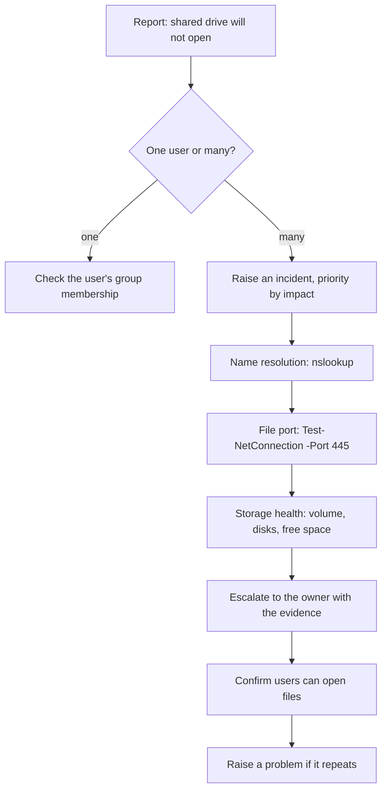

# Shared file service recovery

**The situation:** Staff in the office cannot open the shared drive. The cause could be storage, network or permissions.

## What I did in real work

At TikTok I worked this with the owning team. My part was on site: I checked
the network path with `nslookup` and `Test-NetConnection`, and I escalated
with that evidence to the team that owned the service.

## The process I follow

1. Ask the user which share, which error and since when.
2. Check if one user or many users are affected.
3. One user: check the user's group membership for that share.
4. Many users: raise an incident and set the priority by impact.
5. Check name resolution: `nslookup fileserver.example.com`
6. Check the file sharing port: `Test-NetConnection fileserver.example.com -Port 445`
7. Ask the owner to check storage health: volume status, disk status and free space.
8. Escalate to the owning team with the results of steps 5 to 7.
9. After the fix, confirm users can open and save files.
10. If the same fault comes back, raise a problem and link the incidents.

## Proof

Process only, no screenshot in the lab for this tool. The closest proof:

- The same incident and problem pattern, from the lab outage: [major incident ITSM-2](../projects/07-jira-service-management-lab/screenshots/25-major-incident-ITSM-2.jpg), [timeline](../projects/07-jira-service-management-lab/screenshots/26-major-incident-timeline.jpg) and [problem ITSM-5](../projects/07-jira-service-management-lab/screenshots/27-problem-ITSM-5-root-cause.jpg)
- [Agent runbook: major incident and hand-off to problem](../projects/07-jira-service-management-lab/manuals/agent-runbook.md#2-major-incident-the-first-60-minutes)
- [Read-only script that lists a user's groups: Get-UserAccessSnapshot.ps1](../projects/08-identity-endpoint-lifecycle/Get-UserAccessSnapshot.ps1)
- [Generic storage and network validation checklist](../projects/03-virtualisation-infrastructure/validation-checklist.md)

## Tools

- `nslookup`, `Test-NetConnection`, Entra ID groups, Jira Service Management incidents and problems
- Familiar: same process, different system. QNAP storage.

---

Lab work uses synthetic data. No employer data is published.
