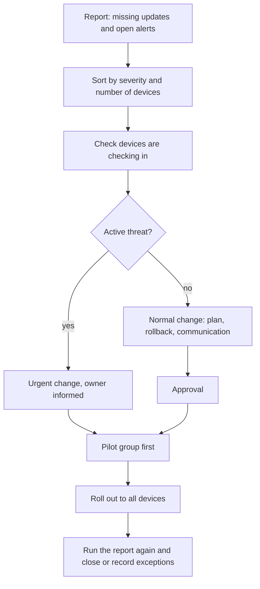
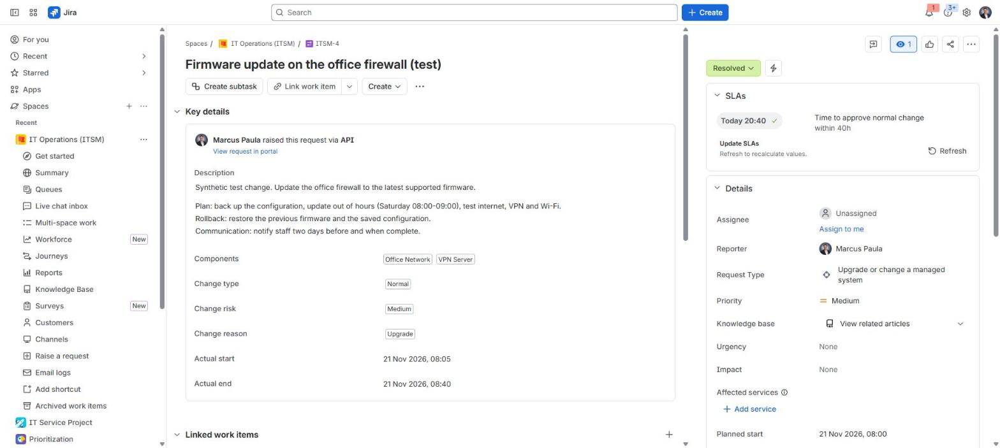
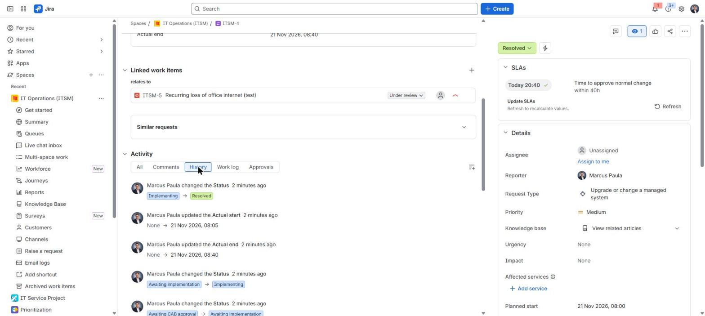

# Missing patches and open security alerts

**The situation:** A report shows many laptops missing updates and a list of open security alerts. Nobody has a plan to close them.

## What I did in real work

At TikTok I kept device images current. I tested the image every day, and the
standard checklist after imaging included Windows updates and vendor updates.
For security alerts, I worked this with the owning team.

## The process I follow

1. Export the report of missing updates and open alerts.
2. Sort by severity and by the number of devices affected.
3. Check that the devices are checking in. A device that does not check in cannot get the update.
4. If there is an active threat, raise an urgent change and inform the security owner.
5. Otherwise, raise a normal change with a plan, a rollback and a communication step.
6. Get approval.
7. Deploy to a small pilot group first.
8. Check the pilot devices work.
9. Roll out to all devices.
10. Run the report again. Close the alerts that are fixed. Record any exception with an owner and a date.

## Proof

There is no Defender or patch tool screenshot in the lab. The lab change
`ITSM-4` is the model I use for a patch change: plan, rollback,
communication and approval before any work.

- [Project 01: post-image checklist with Windows and vendor updates](../projects/01-endpoint-imaging-optimisation/endpoint-validation-checklist.md)
- [Read-only script: Get-EndpointReadiness.ps1, includes the Windows Update service state](../projects/01-endpoint-imaging-optimisation/Get-EndpointReadiness.ps1)
- [Admin guide: change workflow and CAB](../projects/07-jira-service-management-lab/manuals/admin-guide.md#6-change-workflow-and-cab)
- [Build log, Step 12](../projects/07-jira-service-management-lab/build-log.md#step-12--incident-problem-and-change-itsm)

## Tools

- Windows Update, Jira Service Management change management
- Familiar: same process, different system. Microsoft Defender, Intune update rings, Jamf.

---

Lab work uses synthetic data. No employer data is published.
