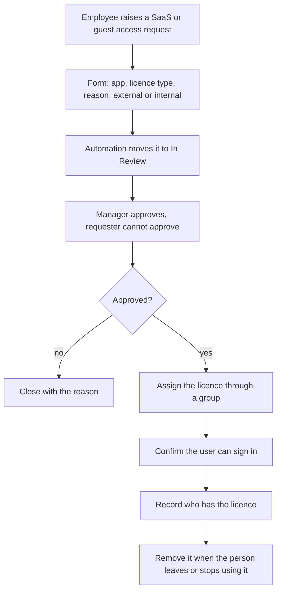
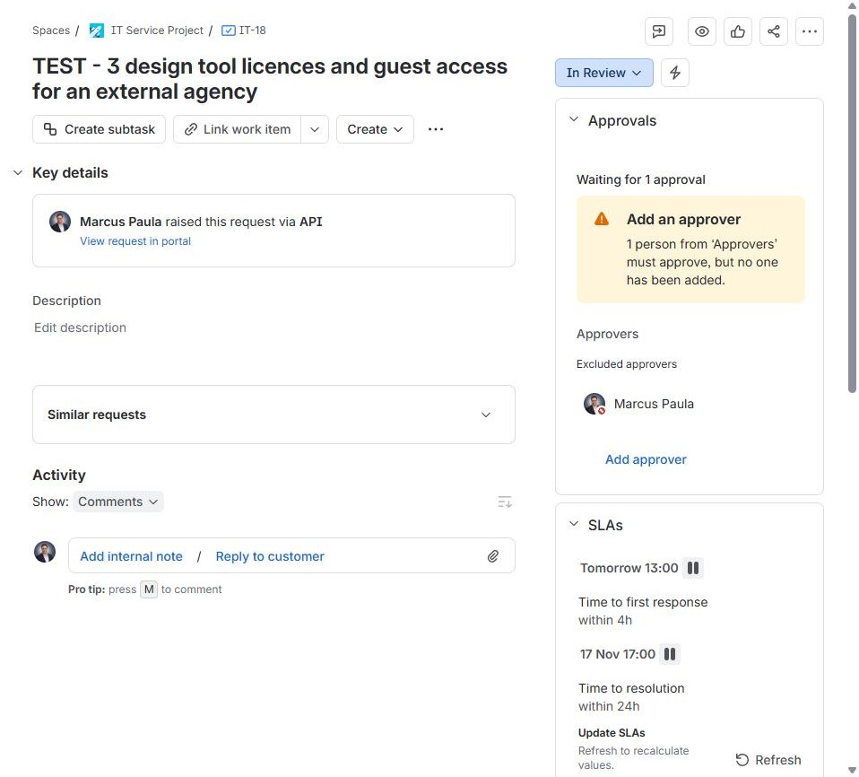
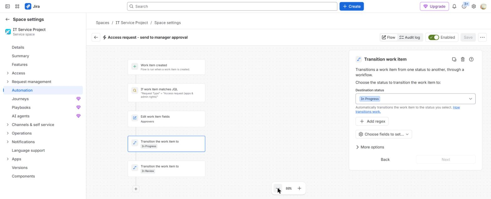
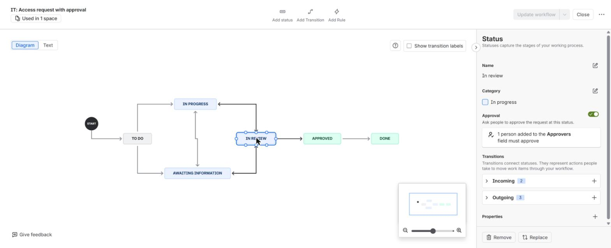
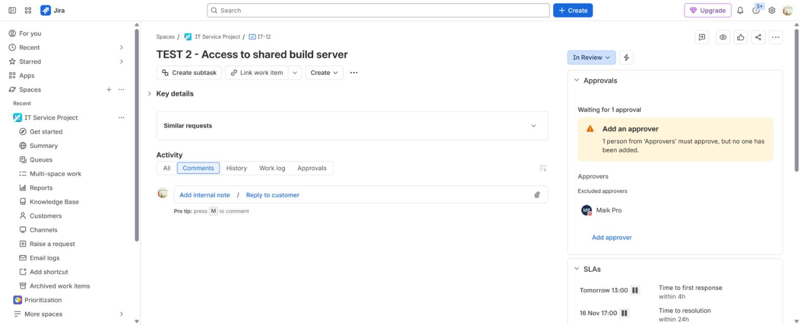

# SaaS licence and external access request

**The situation:** An employee asks for a paid app licence. Another asks to give an outside partner access to a work tool. Both cost money or open data.

## What I did in real work

At TikTok I assigned Microsoft 365 licences and added people to security
groups based on their role. I did not administer other SaaS apps there.

## The process I follow

1. The employee raises the request in the portal.
2. The form asks for the app, the licence type, the reason and whether a guest is external.
3. Automation moves the request to In Review.
4. The manager approves or rejects it. The requester cannot approve their own request.
5. If it is rejected, close the request with the reason.
6. If it is approved, assign the licence through a group.
7. Confirm the user can sign in.
8. Record who has the licence.
9. Remove the licence when the person leaves or stops using the app.

## Proof

- [Build log, Step 15: SaaS licence or external guest access, test IT-18](../projects/07-jira-service-management-lab/build-log.md#step-15)
- [Build log, Step 8: workflow and approvals](../projects/07-jira-service-management-lab/build-log.md#step-8--workflow-and-approvals)
- [Build log, Step 9: the failed run and the fix](../projects/07-jira-service-management-lab/build-log.md#step-9--testing-and-troubleshooting)
- [Project 09: group-based licensing for joiners and leavers](../projects/09-identity-lifecycle-automation/README.md)

## Tools

- Microsoft 365 licences, Entra ID groups, Jira Service Management approvals
- Familiar: same process, different system. At TikTok we used Lark. Similar apps such as Teams, Slack, Adobe, Autodesk and Miro follow the same process.

---

Lab work uses synthetic data. No employer data is published.
