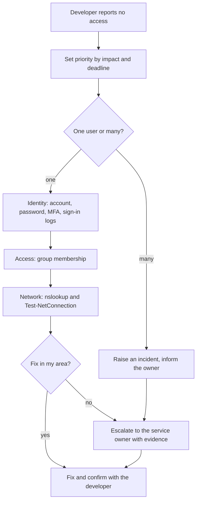

# Developer cannot access a critical service

**The situation:** A developer cannot reach the build server or a remote workstation on the day of a release.

## What I did in real work

At TikTok I supported Entra ID sign-in and group problems, and I owned L2 and
L3 escalations in Jira. When the service belonged to another team, I worked
this with the owning team and escalated with evidence.

## The process I follow

1. Ask what fails, the exact error and since when.
2. Set the priority by impact and by the release deadline.
3. Check if one user or many users are affected. Many users means an incident for the service owner.
4. Check the account: enabled, password, MFA and the sign-in logs.
5. Check group membership for the service.
6. Check the network path: `nslookup build.example.com` and `Test-NetConnection build.example.com -Port 443`
7. If the fix is in my area, fix it.
8. If not, escalate to the service owner with the results of steps 4 to 6.
9. Confirm with the developer that access works.
10. Write the fix in the ticket.

## Proof

Process only, no screenshot in the lab for this tool. The closest proof:

- [Troubleshooting guide: sign-in, MFA and access problems](../projects/08-identity-endpoint-lifecycle/troubleshooting-guide.md)
- [Read-only script for account state, groups and MFA methods: Get-UserAccessSnapshot.ps1](../projects/08-identity-endpoint-lifecycle/Get-UserAccessSnapshot.ps1)
- When the developer needs new access, it goes through approval: [IT-12 waiting for approval](../projects/07-jira-service-management-lab/screenshots/16-test-approval-IT-12.jpg)
- [Build log, Step 12: incident handling](../projects/07-jira-service-management-lab/build-log.md#step-12--incident-problem-and-change-itsm)
- [Agent runbook: triage](../projects/07-jira-service-management-lab/manuals/agent-runbook.md#1-triage)

## Tools

- Entra ID sign-in logs, `nslookup`, `Test-NetConnection`, Jira Service Management
- Familiar: same process, different system. Jenkins and Parsec access, SSO.

---

Lab work uses synthetic data. No employer data is published.
