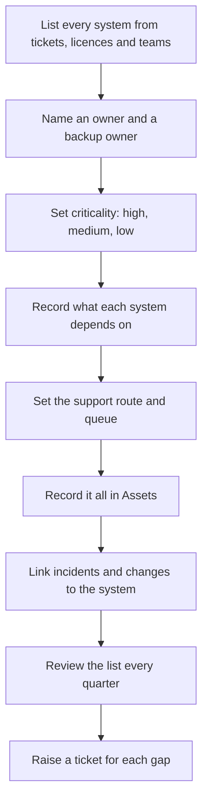
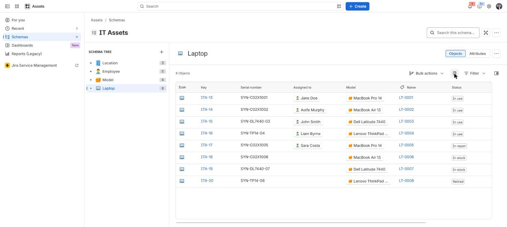
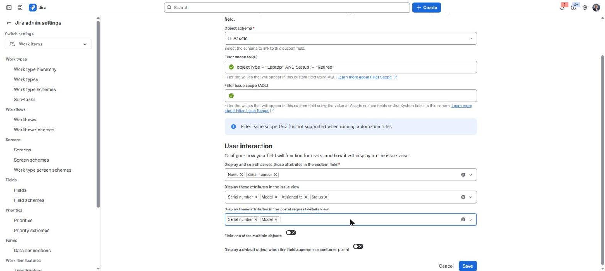
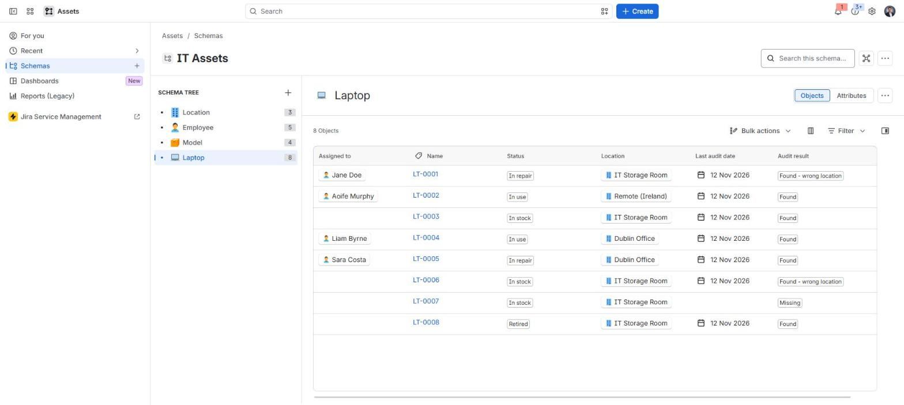

# Systems inventory and ownership

**The situation:** The company runs about 30 systems. Nobody has one list that says who owns each system, how critical it is and who to call when it fails.

## What I did in real work

At TikTok I helped design a scan-based asset audit. It covered more than 5,000
assets and reached 99% visibility. That was hardware. I did not build a
register of systems and services there. For those, I worked with the owning
teams.

## The process I follow

1. Build the list of systems from tickets, licences, invoices and team leads.
2. Name an owner and a backup owner for each system.
3. Set the criticality: what stops if the system fails, and for how long the business can wait.
4. Record what each system depends on, for example the network, identity or a supplier.
5. Set the support route: which queue and which team.
6. Record the systems in Assets, with owner and criticality as attributes.
7. Link incidents and changes to the system they affect.
8. Review the list every quarter with the owners.
9. Raise a ticket for each gap, for example a system with no owner.

## Proof

The lab has a hardware register with owners and locations. A systems register
with owner and criticality is design only, not built.

- [Configuration: Assets schema](../projects/07-jira-service-management-lab/configuration.md#8-assets-cmdb)
- [Admin guide: Assets schema and AQL](../projects/07-jira-service-management-lab/manuals/admin-guide.md#2-assets-schema)
- [Procedure: scan-based asset audit](../projects/07-jira-service-management-lab/procedures/scan-based-asset-audit.md)
- [Audit reconcile tool](../projects/07-jira-service-management-lab/tools/asset-audit-reconcile/README.md) and [its tests](../projects/07-jira-service-management-lab/tools/asset-audit-reconcile/tests/test_reconcile.py)
- [Project 02: the real asset audit](../projects/02-asset-management-audit/README.md)
- [Build log, Step 13: audit and return](../projects/07-jira-service-management-lab/build-log.md#step-13--asset-audit-and-laptop-return)

## Tools

- Jira Service Management Assets, AQL, Python, CSV exports

---

Lab work uses synthetic data. No employer data is published.
