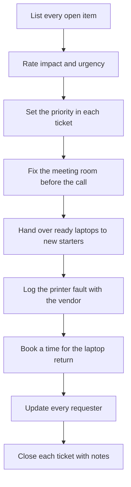
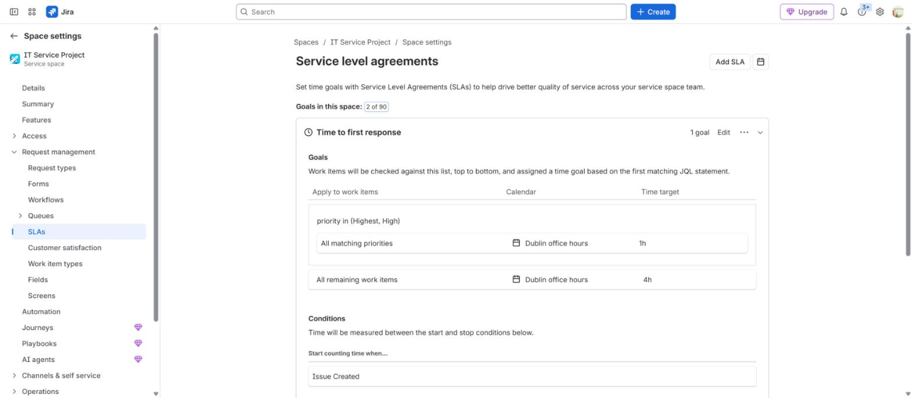
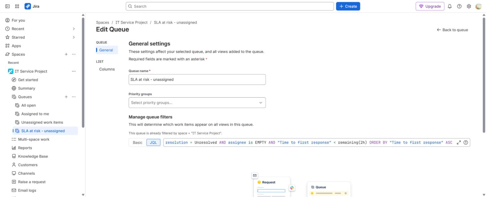
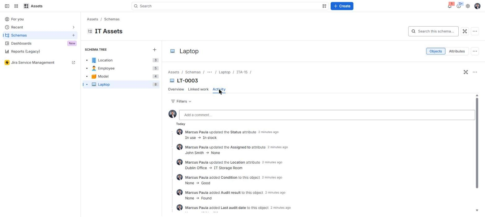
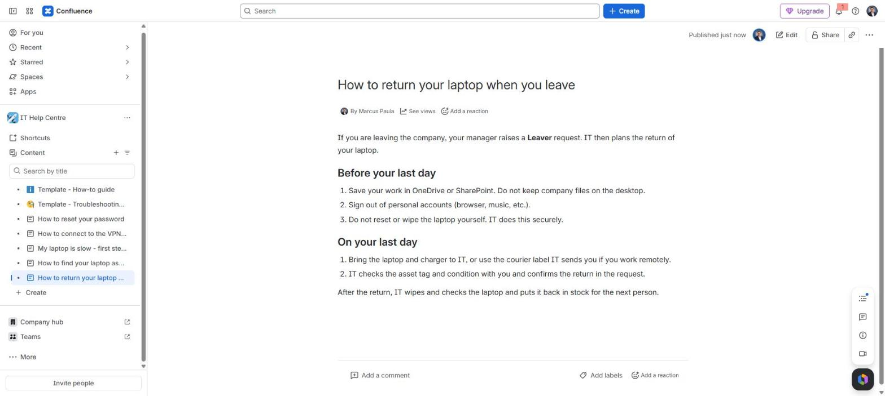

# On-site prioritisation

**The situation:** It is Monday morning. Two new starters arrive at 10:00, a meeting room fails before a leadership call, a printer is down and a leaver is returning a laptop.

## What I did in real work

At TikTok I set priorities on tickets every day and worked to SLAs. I looked
after 19 meeting rooms on Lark and Zoom. I worked on the asset return process
in three sites, and I handled logistics with couriers and vendors.

## The process I follow

1. List every open item in one place.
2. For each item, ask: how many people are blocked, and is there a fixed time?
3. Set the priority in each ticket.
4. Fix the meeting room first. The call has a fixed time and many people.
5. Hand over the new starter laptops. Accounts and laptops were prepared before the day.
6. Log the printer fault with the vendor and tell staff which printer to use now.
7. Book a time for the laptop return. Check the asset tag and the condition when it arrives.
8. Update every requester on what happens next and when.
9. Close each ticket with notes.

## Proof

- [Project 05: meeting room readiness, 19 rooms](../projects/05-meeting-room-readiness/README.md) and [the room checklist](../projects/05-meeting-room-readiness/meeting-room-checklist.md)
- [Project 04: asset return in three sites](../projects/04-asset-return-redeployment/README.md)
- [Agent runbook: triage](../projects/07-jira-service-management-lab/manuals/agent-runbook.md#1-triage)
- [Agent runbook: laptop return on a Leaver request](../projects/07-jira-service-management-lab/manuals/agent-runbook.md#5-laptop-return-on-a-leaver-request)
- [Build log, Step 4: SLAs](../projects/07-jira-service-management-lab/build-log.md#step-4--slas-goals-and-conditions)

## Tools

- Jira Service Management, Lark, Zoom, courier and vendor portals

---

Lab work uses synthetic data. No employer data is published.
