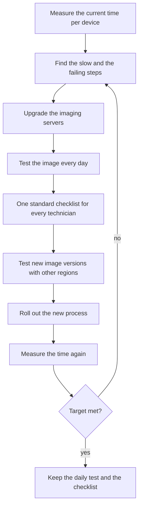
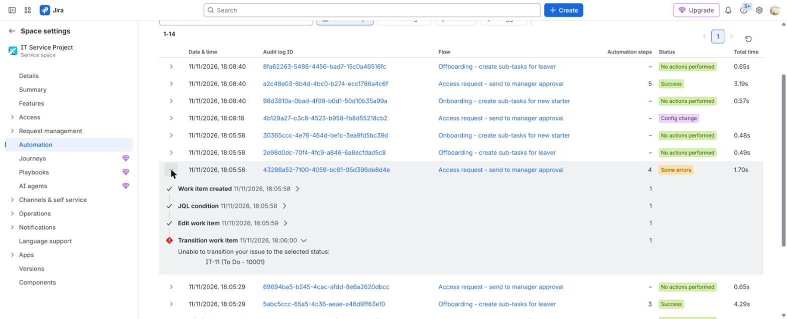

# Process improvement: imaging from 60 to 15 minutes

**The situation:** Preparing one laptop takes about an hour. Results are different from one technician to the next, and laptops wait in a queue.

## What I did in real work

At TikTok I cut imaging time from about 60 minutes to 15 minutes per device.
We deployed the images with MCU. I upgraded the imaging servers, set up a
daily image test, introduced a standard checklist, and tested image versions
with colleagues in other regions.

## The process I follow

1. Measure how long one device takes today, from start to ready.
2. Find the steps that are slow and the steps that fail.
3. Upgrade the imaging servers.
4. Test the image every day on a test device, so a bad image is found before it reaches users.
5. Write one standard checklist that every technician follows.
6. Test each new image version with colleagues in other regions before it goes live.
7. Roll out the new process.
8. Measure the time per device again.
9. If the target is not met, go back to step 2.
10. Keep the daily test and the checklist as normal work.

## Proof

Process only, no screenshot in the lab for this tool. The closest proof:

- [Project 01: imaging improvement](../projects/01-endpoint-imaging-optimisation/README.md)
- [Project 01: post-image validation checklist](../projects/01-endpoint-imaging-optimisation/endpoint-validation-checklist.md)
- [Read-only check after imaging: Get-EndpointReadiness.ps1](../projects/01-endpoint-imaging-optimisation/Get-EndpointReadiness.ps1)

The same habit in the lab: test, find the cause, fix, test again. A flow failed,
the audit log showed a missing workflow step, and the next test passed.

- [Build log, Step 9: testing and troubleshooting](../projects/07-jira-service-management-lab/build-log.md#step-9--testing-and-troubleshooting)

## Tools

- MCU for image deployment, Linux and Windows imaging servers, PowerShell
- Familiar: same process, different system. Intune, Jamf and Mosyle zero-touch enrolment.

---

**Author:** Marcus Paula

Lab work uses synthetic data. No employer data is published.
