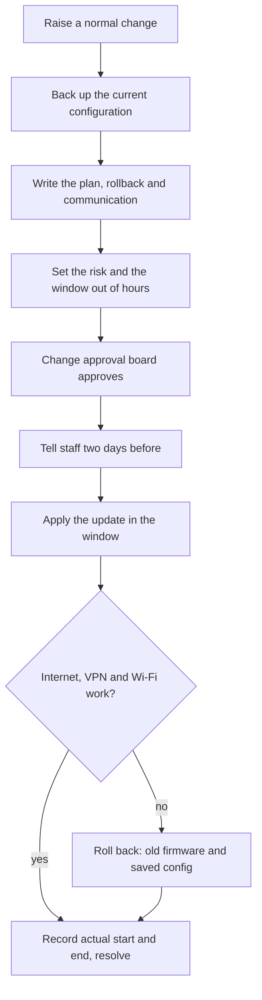
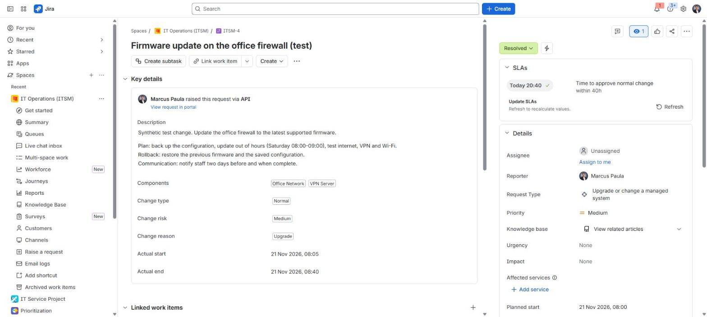
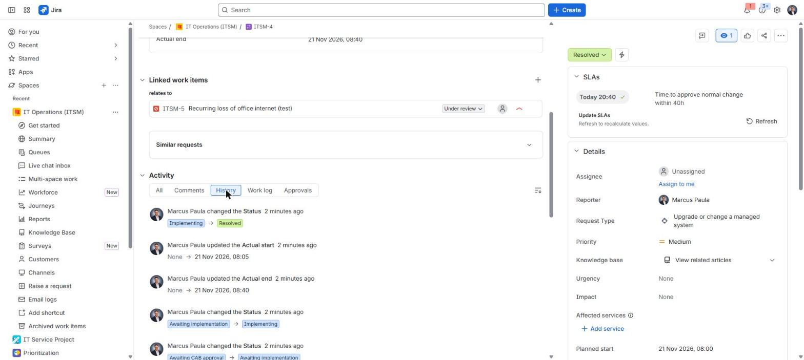

# Firewall management

**The situation:** The office firewall needs a firmware update. A mistake can stop internet and VPN for everyone in the office.

## What I did in real work

At TikTok the firewall and VPN were owned by the network team. I did the
on-site troubleshooting with `nslookup` and `Test-NetConnection`, and I
escalated to the network team with evidence.

## The process I follow

1. Raise a normal change for the firmware update.
2. Back up the current firewall configuration.
3. Write the plan, the rollback and the communication.
4. Set the risk and pick a window out of hours.
5. Get approval from the change approval board.
6. Tell staff two days before the window.
7. Apply the update in the window.
8. Test internet, VPN and Wi-Fi.
9. If a test fails, roll back to the old firmware and the saved configuration.
10. Record the actual start and end times, tell staff it is done and resolve the change.

## Proof

- [Build log, Step 12: change ITSM-4](../projects/07-jira-service-management-lab/build-log.md#step-12--incident-problem-and-change-itsm)
- [Admin guide: change workflow and CAB](../projects/07-jira-service-management-lab/manuals/admin-guide.md#6-change-workflow-and-cab)
- [Configuration: change workflow and CAB approval](../projects/07-jira-service-management-lab/configuration.md#10-change-workflow-and-cab-approval)
- Related outage and its problem record: [scenario 08](08-office-internet-outage-first-60-minutes.md)

## Tools

- Jira Service Management change management, `nslookup`, `Test-NetConnection`
- Familiar: same process, different system. FortiGate rules, VPN, firmware and configuration backups.

---

Lab work uses synthetic data. No employer data is published.
